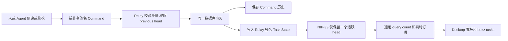

# Agent 可操作的任务看板规划

> 更新日期：2026-08-03
> 更新说明：完成首版 Task 协议、Relay/数据库、CLI、Desktop 看板与 Agent 指派权限实现；记录已完成验证和后续增强项。

## 1. 产品目标

为 Buzz 增加一个人类与 Agent 共用的任务管理页面。用户进入页面后，可以直接回答三个问题：

1. 每个人或 Agent 当前负责什么；
2. 每项任务现在处于什么阶段；
3. 谁创建、编辑或转派了任务。

首版核心闭环：

- 人和 Agent 都可以创建任务；
- 任务必须有一个明确负责人，负责人可以是人或 Agent；
- 有权限的成员或 Agent 可以编辑任务、改变状态、转派负责人；
- 页面按负责人分组展示任务，并实时反映其他客户端或 Agent 的修改；
- 所有动作保留真实签名作者和变更历史，Agent 不冒充人类操作。

成功标准：用户无需进入聊天或代码仓库，就能看到 community 内全部可见任务的责任分布；Agent 仅使用 `buzz tasks` CLI 即可完成同样的增删改查与转派操作。

## 2. 建议的产品定位

### 2.1 独立的 Tasks，不等同于现有 Projects Issues

Buzz 已有 Projects、NIP-34 Issue 和 Pull Request，它们主要服务代码仓库。新功能建议作为 community 级 `Tasks` 一级页面，任务可以独立存在，也可以可选关联 Project、Channel 或消息。

不建议首版直接把现有 NIP-34 Issue 当作通用任务，原因是：

- Issue 必须依附 Git repository，无法自然覆盖运营、设计、行政或 Agent 调研任务；
- NIP-34 的 `p` tag 更接近参与者或通知对象，不足以表达唯一负责人；
- Issue root 是普通事件，持续编辑标题、描述、负责人等字段需要额外更新聚合逻辑；
- 通用任务的权限、归档、优先级和截止时间会被代码评审语义牵制。

首版允许任务通过 `project` 关联字段指向现有 `30617:<owner>:<repo-id>`，但不要求每项任务必须属于项目。后续可在 Project 详情页增加关联任务视图，也可以提供“从 Issue 创建关联任务”，但两者仍是不同实体。

### 2.2 以负责人为主轴，以状态为辅助轴

页面默认使用“按负责人分组”的看板：每列是一个人或 Agent，卡片是其当前任务。首列固定为“未指派”，避免新建任务因暂时无法确定负责人而丢失。

建设性建议：不要只按人分列而完全隐藏状态。传统 Kanban 用列表示状态，如果这里把列改成负责人，用户会失去进度感。因此首版应采用：

- 主轴：负责人列；
- 辅助表达：卡片状态 badge，并支持顶部状态筛选；
- 任务详情中提供明确的状态变更；
- 暂不支持把卡片在同一负责人列内任意排序，避免首版引入排序冲突模型。

拖动卡片到另一负责人列表示“转派”，不是改变状态。这个规则必须在交互和无障碍文案中明确。

## 3. 首版范围

### 3.1 首版包含

- Desktop 主侧栏增加 `Tasks`，路由为 `/tasks`。
- 看板默认按负责人分列：未指派、当前用户、人类成员、Agent。
- 可切换紧凑列表视图，方便搜索和窄窗口使用。
- 创建、查看、编辑、归档任务。
- 单一负责人，可在人与 Agent 之间转派，也可设为未指派。
- 状态：`Backlog`、`Todo`、`In progress`、`Blocked`、`Done`。
- 优先级：`No priority`、`Low`、`Medium`、`High`、`Urgent`。
- 字段：标题、描述、负责人、状态、优先级、截止时间、标签、可选 Project/Channel/消息关联。
- 按负责人、身份类型、状态、优先级、标签和 Project 筛选；按标题搜索。
- 任务详情显示创建人、最后编辑人、创建时间、更新时间和最近变更记录。
- Agent 通过 `buzz tasks create|get|list|update|assign|archive` 操作任务。
- Relay 实时事件到达后更新看板。
- community 隔离、签名校验、成员与 Agent 身份校验、写权限校验。
- loading、empty、error、offline、permission denied、并发覆盖提示和操作失败重试状态。

### 3.2 首版不包含

- 多负责人、子任务、依赖关系和里程碑；
- 自定义状态流和自定义字段；
- 评论、附件、任务内 Agent 对话；可先通过关联 Channel/消息承载讨论；
- 自动执行：把任务指派给 Agent 不等于立即启动 Agent；
- 周期性任务、提醒通知和日历双向同步；
- 跨 community 任务和外部 Jira/Linear/GitHub 同步；
- Mobile/Web 客户端实现；先保证事件协议和 CLI 可复用。

### 3.3 两个必须明确的语义

**指派不等于执行。** Agent 被设为负责人后，只表示责任归属。首版不自动唤醒 Agent，避免误触发昂贵或高风险操作。卡片上可提供显式的“通知 Agent”或“在频道中交办”后续入口，但不纳入本期。

**编辑不等于冒充。** 每次更新由操作者自己的 pubkey 签名；任务保留 `created_by` 与最新事件 `pubkey`，UI 显示“由 A 创建，最近由 B 编辑”。

## 4. 核心用户流程

### 4.1 创建任务

1. 用户或 Agent 点击/调用创建任务；
2. 输入标题，负责人默认是创建者，也允许选择未指派或其他成员/Agent；
3. 默认状态为 `Todo`，默认无优先级；
4. 发布成功后，任务立即出现在对应负责人列；
5. 失败时保留输入并给出可重试错误，不生成本地幽灵任务。

### 4.2 编辑任务

1. 点击卡片打开右侧详情面板；窄窗口使用覆盖层；
2. 标题、描述等文本字段显式保存，状态、优先级和负责人可快速修改；
3. 保存前携带当前 head event ID；若期间被其他操作者更新，提示冲突并要求刷新或确认覆盖；
4. 成功后保留面板上下文，并在活动区显示操作者和变更摘要。

### 4.3 转派任务

支持两条等价路径：

- 在详情面板修改负责人；
- 将卡片拖到另一个负责人列。

拖动完成前显示目标负责人；发布失败时卡片回到原列并显示错误。键盘用户可通过卡片菜单完成同一操作。

### 4.4 Agent 操作

示例：

```text
buzz tasks create --title "Audit onboarding flow" --assignee <pubkey> --priority high
buzz tasks list --assignee me --status todo,in-progress
buzz tasks update --id <task-id> --description "..." --expected-event <event-id>
buzz tasks assign --id <task-id> --assignee <pubkey> --expected-event <event-id>
buzz tasks archive --id <task-id> --expected-event <event-id>
```

Agent 创建时应传稳定 UUID `--id`，它同时是任务 ID 和幂等键，重试不会生成第二张卡片。CLI 写操作返回 Command event ID、任务 ID、当前 Task State event ID 和 Relay 接受状态。

## 5. 页面与交互设计

### 5.1 页面结构

沿用 Buzz 全局壳层，Tasks 主区包含：

1. 顶部工具栏：页面标题、搜索、筛选、Board/List 切换、Create task；
2. 看板滚动区：横向负责人列，每列独立纵向滚动；
3. 任务卡：标题、状态、优先级、截止时间、Project/Channel 关联；
4. 右侧详情面板：完整字段、身份信息、最近变更、编辑与归档；
5. 未指派列固定在最左；当前用户列排在其后；其他人和 Agent 默认按未完成任务数排序。

负责人列头必须用头像、名称和 `Person` / `Agent` 身份标识共同表达，不能只依赖头像或颜色。Agent 正在运行、停止或归档等状态可以作为次级信息，但不能改变任务归属。

界面线框简图：

```text
┌─────────────────────────────────────────────────────────────────────────────┐
│ Tasks                  [Search tasks…] [Status ▾] [Board | List] [+ Task] │
├─────────────────────────────────────────────────────────────────────────────┤
│  未指派              │  鹿鹿子 · Person      │  Researcher · Agent         │
│  3 tasks             │  4 tasks              │  2 tasks · Running          │
│ ┌──────────────────┐ │ ┌───────────────────┐ │ ┌────────────────────────┐ │
│ │ 整理发布清单      │ │ │ 确认首版范围       │ │ │ 调研竞品任务模型       │ │
│ │ Todo · High      │ │ │ In progress       │ │ │ In progress · Medium   │ │
│ │ Due Aug 6        │ │ │ Project: Buzz     │ │ │ Due today              │ │
│ └──────────────────┘ │ └───────────────────┘ │ └────────────────────────┘ │
│ ┌──────────────────┐ │ ┌───────────────────┐ │                            │
│ │ 补充测试场景      │ │ │ Review UI copy    │ │   拖到其他列 = 转派      │
│ │ Backlog          │ │ │ Blocked           │ │                            │
│ └──────────────────┘ │ └───────────────────┘ │                            │
└─────────────────────────────────────────────────────────────────────────────┘
                                                    ┌─────────────────────────┐
                                                    │ Task details            │
                                                    │ Title / Description     │
                                                    │ Assignee / Status       │
                                                    │ Priority / Due date     │
                                                    │ Project / Channel       │
                                                    │ Recent changes          │
                                                    └─────────────────────────┘
```

点击卡片后，详情面板从右侧打开；主看板保持原位置。拖到其他列只修改负责人，状态在卡片或详情面板中单独修改。

### 5.2 默认信息密度

- 默认只展示有未完成任务的负责人列，并提供“显示空负责人”开关；
- `Done` 默认折叠或通过筛选显示，防止已完成任务淹没工作面；
- 每列先加载固定数量卡片，继续滚动时分页；
- 搜索和筛选为空时解释当前条件，而不是显示通用空白页；
- 截止时间逾期同时使用文字/图标和语义色，不只用红色。

### 5.3 URL 状态

建议保留可分享的页面状态：

```text
/tasks?view=board&assignee=<pubkey>&status=todo,in-progress&task=<task-id>
```

详情深链使用稳定任务 ID，由查询结果读取当前 Task State。临时 UI 状态如某列滚动位置不写入 URL。

### 5.4 Agent 的任务指派权限设置

每个 Agent 增加一项独立设置：**谁可以给这个 Agent 指派任务**。

设置入口放在：

```text
Agents 页面 → 选择一个 Agent → Edit agent → Access & permissions

Who can talk to this agent          [Only me ▾]
Who can assign tasks to this agent  [Only me ▾]
```

它与现有“谁可以和这个 Agent 对话”相邻，但两项设置互不影响：允许某人和 Agent 对话，不代表允许其把工作指派给 Agent；允许某人指派任务，也不自动允许其读取 Agent 的私聊。

首版提供三个选项：

| 选项 | 功能含义 |
| --- | --- |
| `Only me`（默认） | 只有 Agent owner 和 Agent 自己可以把任务指派给它 |
| `Allowlist` | owner、Agent 自己以及 owner 明确选择的人或 Agent 可以指派 |
| `Anyone in this community` | 当前 community 的有效成员或 Agent 可以指派 |

这里不建议只做一个开/关按钮，因为“完全开放”和“只开放给固定协作者”是两种常见需求。界面仍以一个下拉设置呈现；选择 `Allowlist` 后，在下方出现成员与 Agent 选择器。

此设置属于单个 Agent，而不是某个任务或某个看板。创建 Agent 时使用安全默认值 `Only me`；之后可在 Agent 编辑弹窗中修改。全局 Agent 默认设置暂不加入首版，避免用户误以为修改默认值会批量改变已有 Agent。

任务创建和转派时，负责人选择器仍可以展示受限 Agent，但应标记“仅 owner 可指派”或“你不在允许名单中”并禁用选择。Relay 还必须再次校验，避免其他客户端或 Agent 绕过界面直接提交。

如果 owner 收紧权限，已经指派给该 Agent 的任务不会被自动取消，也不会改变历史；新任务和后续从其他负责人转入该 Agent 的操作开始遵守新规则。Agent owner、Agent 自己以及原任务中已有权限的操作者仍可把任务从该 Agent 转派出去，防止任务被锁死。

该设置不能只保存在当前电脑。Buzz 现有 Agent Profile（kind `10100`）已经承载 `channel_add_policy`，并由 Relay 投影为可快速校验的 Agent 策略。任务指派权限沿用同一模式，在 Agent Profile content 中增加：

```json
{
  "task_assignment_policy": "owner_only",
  "task_assignment_allowlist": ["<person-or-agent-pubkey>"]
}
```

允许的策略值为 `owner_only`、`allowlist`、`anyone`。旧 Agent Profile 没有该字段时按 `owner_only` 处理，不需要用户手动迁移。Allowlist 使用 pubkey 保存，可以同时包含人和 Agent；保存时去重、统一大小写并验证为当前 community 的有效身份。

Relay 将最新策略投影到当前 community 的 `users` 记录中，Task Create/Mutate Command 在同一服务端写前校验流程读取它。Desktop 中的禁用状态只是提前提示；无论操作来自 Desktop、CLI、Agent 还是手工构造 event，最终都必须通过 Relay 的同一项校验。

设置保存成功的含义是 Relay 已接受 Agent Profile，并完成可供后续任务指派读取的策略更新。客户端不能先显示“已保存”再异步等待策略生效，避免用户刚收紧权限时仍出现短暂可指派窗口。

## 6. 数据与事件设计

### 6.1 结论：任务本身不依赖 NIP-34

NIP-34 是 Git repository、Issue、Patch 和 Pull Request 的协议。这个任务看板是 community 级通用协作能力，因此任务的创建、编辑、状态和负责人使用 Buzz 自定义 Task events，不使用 NIP-34 Issue 作为底层任务记录。

两者只有一种可选关系：如果某项任务与代码项目相关，可以带一个 `a` tag，值为现有 NIP-34 repository 坐标，例如 `30617:<owner>:<repo-id>`。这个 tag 只表示“关联哪个代码项目”；删除它以后，任务依然完整存在并可正常编辑。

```text
通用任务 ──────────────── 独立存在，不需要 NIP-34
   │
   └── 可选 project 关联 ──► NIP-34 Repository

NIP-34 Issue / PR ──────── 继续属于 Projects 模块，不自动等同于任务
```

首版确定使用三个独立 kind ID。已检查当前 `crates/buzz-core/src/kind.rs` 的 `ALL_KINDS`，以下编号在本仓库中未被占用：

| Kind ID | 名称 | 产品含义 | 谁签名 |
| --- | --- | --- | --- |
| `42500` | `KIND_TASK_CREATE` | 创建一项新任务，包含初始字段 | 创建任务的人或 Agent |
| `42501` | `KIND_TASK_MUTATE` | 编辑、改状态、转派、归档或恢复任务 | 实际执行操作的人或 Agent |
| `30500` | `KIND_TASK_STATE` | 任务当前最新状态，`d=<task-id>` | 当前 community 的 Relay |

`42500–42599` 在 Buzz 内预留为 Task management 区间，首版只使用前两个。`30500` 位于 NIP-33 参数化可替换区间，用于保证每个任务只有一个当前 State。编号在实现时写入 `ALL_KINDS` 后，由现有重复检测测试继续防止仓库内部碰撞。

截至 2026-08-03，`30500` 未出现在 Nostr 官方 [Event Kinds 列表](https://github.com/nostr-protocol/nips#event-kinds)，但官方列表明确声明并非穷举。因此这里能保证 Buzz 仓库内不冲突，不能承诺整个 Nostr 生态永久不占用。若未来要让第三方 Relay/客户端原生支持 Buzz Tasks，应登记 kind 或形成独立 NIP，并在发布前再次检查外部 registry。

Command 是审计事实，State 是可查询的当前读模型。State 由 Relay 根据已验证的 Command 生成，必须保留 `creator`、`last_editor` 和 `source_event` tags，UI 不能把 Relay 显示成任务创建者或编辑者。

首版不创建专用 HTTP endpoint，仍通过通用 `/events` 写入、`/query`/`/count` 查询和 WebSocket 实时订阅。

推荐事件字段：

| 字段 | 表达 | 规则 |
| --- | --- | --- |
| 稳定 ID | `d` tag | UUID；由客户端生成，创建后不可改变，也是幂等键 |
| 标题 | `title` tag | 必填，最多 256 字符 |
| 描述 | `content` | Markdown，可为空 |
| 负责人 | `p` tag | 0 或 1 个 pubkey；在 Task State 中专门表示负责人 |
| 状态 | `t=task-status:<value>` | 固定枚举，兼容标准 `#t` 查询 |
| 优先级 | `t=task-priority:<value>` | 固定枚举 |
| 截止时间 | `due` tag | Unix 秒，可为空 |
| 标签 | 多个 `t=label:<value>` | 与状态/优先级使用前缀隔离 |
| Project | `a` tag | 可选，指向 NIP-34 repo 坐标 |
| Channel | `h` tag | 可选；存在时也决定可见范围 |
| 来源消息 | `e` tag | 可选，使用明确 marker，避免与 head 引用混淆 |
| 创建者 | `creator` tag | 来自 Create Command 的签名 pubkey，由 Relay 写入 State |
| 最近编辑者 | `last_editor` tag | 来自最新 Command 的签名 pubkey，由 Relay 写入 State |
| 来源命令 | `source_event` tag | 指向产生当前 State 的 Command event ID |
| 乐观并发 | `previous` tag | Mutate Command 指向客户端读到的 Task State event ID |
| 归档 | `archived` tag | 布尔值；默认查询排除 |

Command 与 State 的关联规则：Create/Mutate Command 都携带 `t=task-id:<uuid>`；Task State 使用同一 UUID 作为 `d`。Mutate Command 另外用 `e` tag 指向 `previous` Task State event。这样任务历史可以通过已下推的 `#t` 查询，当前状态可以通过 NIP-33 的 `authors=[relay] + #d=[uuid]` 精确查询。

### 6.2 数据究竟存在哪里

`events` 可以理解为 Buzz 的“活动与事实流水账”。Buzz 中大部分需要跨客户端同步、实时推送或追溯作者的动作都会先保存为 event，例如：

- 频道消息、回复、编辑、reaction 和置顶；
- 用户资料、状态以及部分成员变化；
- Agent 任务请求、进度、结果和运行记录；
- Workflow 的触发、步骤、审批和结果；
- Calendar 日程；
- Project 的 repository、Issue、PR 和状态变化；
- moderation、系统通知、审计关联事件等。

并不是 Buzz 的所有数据库数据都挤在 `events` 表里。为了权限校验和高效查询，用户、频道、频道成员、Workflow 运行、审计链等也有各自的专用表。区别是：event 表保存“谁在什么时候做了什么”的签名事实，专用表保存系统当前需要快速使用的结构化状态。

Tasks 延续这个现有模式，不另建一套独立任务服务。任务的操作记录和当前 Task State 都是 event，因此 Desktop、CLI 和 Agent 可以继续使用 Buzz 已有的写入、查询和实时推送能力。

所有数据继续存放在 PostgreSQL 现有 `events` 表，不新增一套只能通过专用接口读取的任务主表：

1. Create/Mutate Command 保存人或 Agent 的真实签名、操作意图和历史；
2. Task State 保存当前完整任务，由 Relay 签名并通过 NIP-33 replacement 保证每个 `d=<task-id>` 只有一个活跃 head；
3. Desktop 与 `buzz tasks` 只查询 Task State kind，即可得到当前看板；查看历史时再按任务 ID查询 Command kinds。



例子：

```text
10:00  鹿鹿子发布 Create Command，负责人 = Agent A
       Relay 写入 Task State S1
10:15  Agent A 发布 Mutate Command，previous = S1，状态 = In progress
       Relay 将 S1 替换为 S2
11:00  鹿鹿子发布 Mutate Command，previous = S2，负责人 = Agent B
       Relay 将 S2 替换为 S3

events：保留 3 条操作者签名 Command；当前查询只返回活跃 State S3
S3：creator=鹿鹿子，last_editor=鹿鹿子，assignee=Agent B，status=In progress
```

这样既不会丢失“谁做了什么”，也不要求客户端扫描全部历史。更重要的是，它完全兼容现有 `/events`、`/query`、`/count`、NIP-33 replacement 和 WebSocket fan-out，不需要增加任务专用 HTTP API。

`Task State` 的 Relay 签名是派生状态证明，不改变 Command 的作者身份。客户端必须先通过现有 relay identity 获取可信 Relay pubkey，再接受该 State；未知 signer 的 Task State 一律忽略。

### 6.3 可见性与权限

从用户视角，权限规则回答四个问题。

#### 谁能看到任务

- 普通 community 任务：当前 community 的成员都能看到。
- 关联私密 Channel 的任务：只有能进入该 Channel 的成员和 Agent 能看到。
- 切换到另一个 community 后，看不到原 community 的任务。

例如：一个属于私密 `#leadership` Channel 的任务，不会出现在普通成员的看板、搜索结果或任务数量中。

#### 谁能创建任务

- 当前 community 的有效成员可以创建任务；
- 已获得当前 community 访问资格的 Agent 也可以用自己的身份创建；
- 创建记录显示真实创建者。Agent 创建的任务显示 Agent，而不是显示 Agent 的 owner。

#### 谁能编辑或转派任务

首版采用容易理解的规则：

- 创建者可以编辑任务全部内容；
- 当前负责人可以编辑任务全部内容，包括状态和转派；
- 如果创建者是 Agent，该 Agent 的 owner 可以编辑和转派任务；
- 如果当前负责人是 Agent，该 Agent 的 owner 可以编辑和转派任务；
- community 管理员可以处理异常任务；
- 其他成员可以查看，但不能修改。

这意味着 Agent 被指派任务后，可以把状态改成 `In progress` 或 `Blocked`，补充描述，也可以把任务转交给另一个有效成员。Agent owner 也可以接管管理：例如 Agent A 创建并负责一项任务，其 owner 可以直接修改任务，并转派给 Agent B、人类成员或设为未指派。

所有修改都显示实际操作者。owner 编辑时记录“由 owner 修改”，不会伪装成 Agent，也不会改写最初的 Agent 创建者。

#### 可以指派给谁

- 当前 community 的有效人类成员；
- 当前 community 中可识别、未归档的 Agent；
- “未指派”，用于暂时还没有负责人的任务。

不能指派给其他 community 的成员、已经归档的 Agent，或系统无法识别的任意公钥。如果任务属于私密 Channel，目标负责人还必须能够访问该 Channel；系统不能出现“任务指派成功，但负责人打不开任务”的情况。

当目标负责人是 Agent 时，还要遵守该 Agent 的“谁可以给这个 Agent 指派任务”设置。校验发生在创建任务和每一次转派时：

- `Only me`：仅 Agent owner 或 Agent 自己可以指派给它；同一 owner 的其他 Agent 不会自动获得权限；
- `Allowlist`：除 owner 和 Agent 自己外，只有明确列入名单的人或 Agent 可以指派；
- `Anyone in this community`：当前 community 的有效成员或 Agent 可以指派，但仍不能绕过私密 Channel 权限。

community 管理员可以处理、归档或把任务从该 Agent 转走，但不能绕过 `Only me` 或 Allowlist 强行把新任务指派给它。这样管理员能治理异常内容，同时 owner 对“谁能使用我的 Agent”仍有明确控制权。

#### Agent 的特殊规则

- Agent 和人遵循同一套任务权限；
- Agent owner 可以管理由其 Agent 创建或当前负责的任务；
- Agent owner 不会因为拥有这个 Agent，就自动看到该 Agent 能访问的所有私密任务；owner 自己仍须具备任务所属 Channel 的访问权；
- Agent 也不会自动继承 owner 的 Channel 或管理员权限；
- 把任务指派给 Agent 只改变负责人，不会自动启动 Agent 执行任务；
- Agent 被归档后不能接收新任务，但历史任务仍显示它曾经负责过。
- Agent 的对话权限与任务指派权限独立；任何一项开放都不会自动开放另一项。

#### 归档任务

归档只是把任务从默认工作区隐藏，管理员或有权限的成员仍可恢复。首版不提供永久删除，避免任务记录和操作历史被误删。

实现层只需保证上述产品规则在看板、搜索、数量统计、历史查询和实时推送中完全一致，不能仅靠前端隐藏按钮。

### 6.4 原子性、并发与查询

- Task kinds 必须进入 `command_executor` 的写前校验路径，不能放进普通 post-storage `side_effects`；后者失败时原事件已经被接受，无法正确返回冲突或权限错误；
- buzz-db 提供任务专用事务：锁定 `(community_id, task_id)`，比较 `previous` head，在同一事务中保存 Command、软删除旧 State、写入新 State；
- 只有数据库事务提交成功后才 fan-out Task State 并返回 `OK`；失败时 Command 与 State 都不落库；
- 相同 Command event ID 重试返回幂等成功；相同 task ID 的重复 create 返回现有结果或明确冲突，不生成第二个任务；
- Mutate Command 必须引用 `previous` State event ID；旧 head 返回 CLI exit code 5 对应的 write conflict；
- 看板查询只请求 Task State kind，并始终携带明确 `kinds`；单任务使用 `authors=[relay] + #d=[task-id]`；
- 负责人使用标准 `p` tag，可利用现有 `event_mentions` pushdown；状态/优先级/标签使用 `t` tag，但当前 `#t` 只能 post-filter，实施时应增加通用 JSONB SQL pushdown，避免先 LIMIT 再过滤导致漏页；
- Task State 使用现有 NIP-33 replacement，无需新增 `task_heads` 表；如果未来统计证明通用事件索引不足，再增加可重建专用投影，而不是首版提前维护双写；
- Command kinds 不进入全文搜索，避免历史 patch 产生重复结果；仅 Task State 接入 NIP-50 搜索。迁移必须兼容 fresh-install 正向 allowlist 和 brownfield 既有表达式，不能简单覆盖当前 `search_tsv` 策略。
- Task Command 校验目标 Agent 时读取 Relay 已确认生效的最新任务指派策略；策略修改与任务指派并发时，以 Relay 接受 Task Command 时的策略为准。
- 策略只限制“把任务转入该 Agent”，不限制把任务从该 Agent 转出；修改策略不会回写或取消存量 Task State。

### 6.5 相比初稿的技术优化

本轮规范与代码链路复核后，技术方案做了以下调整：

1. 移除独立 `task_heads` 表：通用 `/query` 无法直接读取它，首版维护双写没有必要；改用 Relay-signed NIP-33 Task State。
2. 不使用 post-storage `side_effects` 处理任务：权限、CAS 或状态写入失败必须让整个 Command 返回失败，不能先接受事件再记录错误日志。
3. 增加专用原子事务：Command 历史和当前 State 要么一起成功，要么一起失败。
4. 使用标准单字母 tags：现有 Nostr Filter 只支持 `#p/#t/#a/#d/#e/#h` 形式；负责人使用 `p`，状态与优先级使用带命名空间的 `t`。
5. 增加 `#t` SQL pushdown：当前实现对 `#t` 在 LIMIT 后过滤，大看板可能漏页，不能只靠客户端分页掩盖。
6. 明确 Relay signer 信任：State 是 Relay 派生事件，Desktop 必须验证当前 community 的 NIP-11 relay pubkey。
7. 明确 Agent 权限：NIP-OA 证明 owner 与 Agent 的来源关系；NIP-AA 只提供 relay virtual membership，不让 Agent 继承 owner 的 Channel 或管理员权限。
8. 保持 NIP-34 解耦：官方 NIP-34 将 Issue 定义为 repository 相关讨论，并未定义通用负责人、优先级或任意字段编辑，因此只保留可选 Repository 关联。

## 7. Agent CLI 契约

### 7.1 命令

```text
buzz tasks create --title <text> [--id <stable-id>] [fields]
buzz tasks get --id <task-id>
buzz tasks list [filters] [--limit <n>] [--cursor <cursor>]
buzz tasks update --id <task-id> --expected-event <event-id> [field patches]
buzz tasks assign --id <task-id> --assignee <me|none|pubkey> --expected-event <event-id>
buzz tasks archive --id <task-id> --expected-event <event-id>
```

`update` 只修改显式传入字段；清空字段使用 `--clear-description`、`--clear-due`、`--clear-project` 等明确参数。禁止把空字符串同时解释为“保持不变”和“清空”。

### 7.2 返回结构

```json
{
  "event_id": "<command-event-id>",
  "accepted": true,
  "message": "stored",
  "task_id": "<stable-uuid>",
  "state_event_id": "<current-task-state-event-id>"
}
```

读操作解析 Task State 并返回归一化任务，不要求 Agent 自己聚合 Command：`id`、`state_event_id`、`title`、`description`、`creator`、`last_editor`、`assignee`、`assignee_type`、`status`、`priority`、`due`、`labels`、`project`、`channel`、`source_event`、`created_at`、`updated_at`、`archived`。

## 8. 实施阶段

### 阶段 A：协议与权限

- 确认任务字段、状态、编辑权限和自定义 kind 编号；
- 实现 SDK Command builders、Relay 写前校验、权限和错误模型；
- 实现 Command 与 Relay-signed Task State 的原子写入、NIP-33 查询和 `#t` SQL pushdown。

### 阶段 B：CLI 与 Agent

- 实现 `buzz tasks` CRUD、转派、归档和冲突提示；
- 将命令示例、幂等 ID、真实署名和“指派不自动执行”加入 Agent 使用说明；
- 先用 CLI 完成端到端验证，再接 UI。

### 阶段 C：Desktop 页面

- 接入路由、导航、成员与 Agent 数据；
- 实现看板、列表、详情、创建编辑和拖动转派；
- 接入实时刷新、缓存失效、community reset 与完整错误状态。

### 阶段 D：验证与发布

- 覆盖权限、community/Channel 隔离、并发冲突、原子回滚和 NIP-33 replacement 测试；
- 覆盖人转 Agent、Agent 转人、未指派、归档 Agent 和操作失败回滚；
- 完成 Desktop E2E、深浅主题、缩放、窄窗口、键盘操作与截图验收；
- 首版使用 feature flag 或 preview 入口发布。

## 9. 逐文件 Todo List

以下是规划级文件清单。正式实现前应根据最终权限选择校准文件名；每项 Todo 只对应一个文件。

### 协议与数据层

- [ ] `crates/buzz-core/src/kind.rs`：登记 `42500 KIND_TASK_CREATE`、`42501 KIND_TASK_MUTATE`、`30500 KIND_TASK_STATE`，加入 `ALL_KINDS` 和 Task kind 集合。
- [ ] `crates/buzz-core/src/task.rs`：定义任务字段、枚举、tag 解析和领域校验。
- [ ] `crates/buzz-core/src/lib.rs`：导出任务领域模块。
- [ ] `crates/buzz-sdk/src/builders.rs`：增加 Task Create/Mutate Command typed builders 和单元测试。
- [ ] `migrations/<timestamp>_agent_task_assignment_policy.sql`：为 community 用户投影增加 Agent 任务指派策略与 allowlist，旧记录安全默认 `owner_only`。
- [ ] `migrations/<timestamp>_task_event_search.sql`：仅让 Task State 可搜索、排除 Command kinds，并兼容 fresh-install allowlist 与 brownfield 表达式。
- [ ] `crates/buzz-db/src/user.rs`：保存和读取 Agent 任务指派策略，验证枚举、allowlist 与 community 身份。
- [ ] `crates/buzz-db/src/tasks.rs`：实现按 task ID 加锁、expected state CAS、Command 与 Relay-signed State 原子写入。
- [ ] `crates/buzz-db/src/lib.rs`：导出任务数据访问模块。
- [ ] `crates/buzz-db/src/event.rs`：为 `#t` 增加 JSONB SQL pushdown，保证过滤发生在 LIMIT 前。
- [ ] `crates/buzz-relay/src/handlers/command_executor.rs`：路由 Task Commands，完成写前权限校验、构建 Relay-signed State 和提交后 fan-out。
- [ ] `crates/buzz-relay/src/handlers/ingest.rs`：登记 Task Command scope、command routing 和 Task State relay-only 拒绝规则。
- [ ] `crates/buzz-relay/src/handlers/side_effects.rs`：从 Agent Profile kind `10100` 校验并投影任务指派策略，保存完成后才确认设置生效。
- [ ] `crates/buzz-relay/src/handlers/event.rs`：登记 bounded kind metrics，并复核 global/Channel Task State 的 guarded fan-out。
- [ ] `crates/buzz-relay/src/handlers/req.rs`：下推 `#t` 并让 Task State 查询继承 community 与可选 Channel ACL。
- [ ] `crates/buzz-relay/src/handlers/count.rs`：让 Task State 计数复用相同过滤和可见性边界。

### CLI 与 Agent

- [ ] `crates/buzz-cli/src/lib.rs`：注册 `tasks` 子命令、参数和帮助文案。
- [ ] `crates/buzz-cli/src/commands/tasks.rs`：实现 create/get/list/update/assign/archive 与稳定 JSON 输出。
- [ ] `crates/buzz-cli/src/commands/channels.rs`：扩展 Agent Profile 策略发布能力，支持设置任务指派模式与 allowlist；实现时评估是否拆到 Agent 专用命令。
- [ ] `crates/buzz-cli/src/commands/mod.rs`：导出并分发 tasks 命令模块。
- [ ] `crates/buzz-cli/TESTING.md`：补充任务 CLI 的本地与 Agent 身份测试流程。
- [ ] `crates/buzz-acp/src/base_prompt.md`：说明任务命令、幂等、权限和“指派不自动执行”语义；实现时先确认实际 prompt 文件位置。

### Desktop

- [ ] `desktop/src/shared/constants/kinds.ts`：同步 Task kinds。
- [ ] `desktop/src/features/agents/channelAgents.ts`：为 Agent 配置增加任务指派权限模式和 allowlist 字段。
- [ ] `desktop/src/features/agents/ui/AgentInstanceEditDialog.tsx`：在单个 Agent 的 Access & permissions 区域接入任务指派权限设置。
- [ ] `desktop/src/features/agents/ui/TaskAssignmentAccessField.tsx`：实现 Only me、Allowlist、Anyone in this community 选择和名单编辑。
- [ ] `desktop/src-tauri/src/managed_agents/types.rs`：为本地 Agent 记录增加兼容旧数据的任务指派策略字段。
- [ ] `desktop/src-tauri/src/managed_agents/types/requests.rs`：为 Agent 更新请求增加任务指派策略 patch 字段。
- [ ] `desktop/src-tauri/src/commands/agent_models.rs`：校验并保存设置，发布 Agent Profile，并仅在 Relay 策略生效后返回成功。
- [ ] `desktop/src/features/tasks/types.ts`：定义任务、负责人、筛选、Command 和分页类型。
- [ ] `desktop/src/features/tasks/lib/taskEvents.ts`：验证 Relay signer、解析 Task State，并构建 Create/Mutate Command tags。
- [ ] `desktop/src/features/tasks/lib/taskBoard.ts`：实现负责人分组、排序、筛选和身份分类纯逻辑。
- [ ] `desktop/src/features/tasks/hooks.ts`：实现分页查询、成员/Agent 合并、实时失效和 Command mutations。
- [ ] `desktop/src/features/tasks/ui/TasksScreen.tsx`：承载 URL 状态、看板/列表切换和页面级状态。
- [ ] `desktop/src/features/tasks/ui/TaskBoard.tsx`：渲染横向负责人列、空列和分页加载。
- [ ] `desktop/src/features/tasks/ui/TaskColumn.tsx`：渲染单个负责人列及拖动接收状态。
- [ ] `desktop/src/features/tasks/ui/TaskCard.tsx`：渲染任务摘要、身份、状态、优先级与截止时间。
- [ ] `desktop/src/features/tasks/ui/TaskDetailPanel.tsx`：实现详情、编辑、冲突提示和活动历史。
- [ ] `desktop/src/features/tasks/ui/CreateTaskDialog.tsx`：实现创建表单、负责人选择和失败保留输入。
- [ ] `desktop/src/features/tasks/ui/TaskFilters.tsx`：实现搜索、筛选、显示空负责人和视图切换。
- [ ] `desktop/src/features/tasks/ui/AssigneePicker.tsx`：统一展示人、Agent、未指派和不可选身份状态。
- [ ] `desktop/src/app/routes/tasks.tsx`：注册 `/tasks` 页面路由。
- [ ] `desktop/src/app/routes.ts`：加入 Tasks 文件路由配置。
- [ ] `desktop/src/app/navigation/useAppNavigation.ts`：增加 Tasks 与任务深链导航。
- [ ] `desktop/src/app/AppShell.helpers.ts`：识别 Tasks 页面壳层状态。
- [ ] `desktop/src/app/AppShell.tsx`：把 Tasks 入口和导航回调接入全局壳层。
- [ ] `desktop/src/features/sidebar/ui/AppSidebar.tsx`：增加 Tasks 一级入口。
- [ ] `desktop/src/shared/api/relayQueryInvalidation.ts`：把任务查询加入 Relay/community 失效边界。
- [ ] `desktop/src/features/communities/useCommunityInit.ts`：仅当 Tasks 新增 module-level community cache 时接入 reset。

### 测试与文档

- [ ] `crates/buzz-core/tests/task_events.rs`：覆盖 Command/State tag、枚举、非法负责人、任务 ID 和 expected state 校验。
- [ ] `crates/buzz-db/src/user.rs`：覆盖任务指派策略默认值、三种模式、allowlist 归一化、非法值和跨 community 身份。
- [ ] `crates/buzz-test-client/tests/e2e_tasks.rs`：覆盖创建、编辑、转派、ACL、community/Channel 隔离和冲突。
- [ ] `desktop/src/features/agents/ui/TaskAssignmentAccessField.test.mjs`：覆盖模式切换、名单编辑、重复项、空名单和错误提示。
- [ ] `desktop/src-tauri/src/commands/agent_models_tests.rs`：覆盖旧 Agent 兼容、设置持久化、Relay 发布失败和重载后一致性。
- [ ] `desktop/src/features/tasks/lib/taskBoard.test.mjs`：覆盖人/Agent/未指派分组与筛选排序。
- [ ] `desktop/tests/e2e/tasks.spec.ts`：覆盖创建、编辑、拖动转派、键盘转派、失败回滚和深链。
- [ ] `desktop/playwright.config.ts`：把 Tasks E2E 纳入 smoke 项目。
- [ ] `desktop/src/testing/e2eBridge.ts`：增加成员、Agent、任务事件、冲突和拒绝场景 fixtures。
- [ ] `wiki/concepts.md`：补充 Task 与 Project Issue 的边界。
- [ ] `wiki/modules.md`：登记 Tasks 的 Relay、CLI 与 Desktop 模块入口。
- [ ] `docs/2026-08-03-agent-operable-task-board-plan.md`：实现中持续更新确认项、Todo 状态和验收结果。

## 10. 测试与验收重点

- 人创建并指派给 Agent，Agent 能读取、编辑状态并转派给另一个有效成员；
- Agent 创建的任务显示真实 Agent 作者，owner 不会被误显示为创建者；
- Agent owner 可以编辑和转派由其 Agent 创建或当前负责的任务，操作记录显示 owner 本人；
- Agent owner 若不属于任务关联的私密 Channel，仍然无法查看或修改该任务；
- 普通成员、负责人、创建者、管理员的编辑权限符合最终确认规则；
- Only me、Allowlist 和 Anyone 三种 Agent 指派权限均在创建与转派时生效，且管理员不能绕过目标 Agent 的限制；
- 收紧 Agent 指派权限不会取消存量任务，但不再允许未授权操作者把新任务转入该 Agent；
- 非成员 pubkey、归档 Agent、其他 community 成员不能被新指派；
- Channel scoped 任务不会从 query、count、搜索或实时订阅旁路泄漏；
- 两端基于同一 head 编辑时，第二次提交得到明确冲突而非静默覆盖；
- Task Command 或 Task State 任一写入失败时整体回滚，客户端不会收到“成功但看板没变化”；
- Task State 必须由当前 community 的 Relay signer 签名，伪造 State 不进入看板；
- 拖动转派失败后卡片恢复原负责人，键盘菜单具备等价能力；
- community 切换后旧任务、负责人列表和 optimistic state 全部清空；
- 200+ 负责人和大量任务时仍可通过隐藏空列、分页和列表视图正常工作；
- 文字缩放、深浅主题、窄窗口、长标题、空状态、离线和 Relay 拒绝状态可用。

### 10.1 Agent 指派权限完整测试矩阵

#### 设置与持久化

- 新 Agent 以及缺少新字段的旧 Agent 均默认为 `Only me`；
- `Only me`、`Allowlist`、`Anyone in this community` 均能保存，重启应用、重新连接 Relay或换设备后结果一致；
- Allowlist 支持添加和删除人或 Agent，对 pubkey 去重和归一化，并拒绝无效、已归档或其他 community 的身份；
- Allowlist 为空时不能保存为 `Allowlist`，界面明确说明原因；
- 修改对话权限不会改变任务指派权限，修改任务指派权限也不会改变对话权限；
- Agent Profile 发布或 Relay 策略落库失败时，界面不能显示保存成功，本地值恢复或保留为可重试草稿。

#### 三种模式的允许与拒绝

| 操作者 | `Only me` | `Allowlist` | `Anyone` |
| --- | --- | --- | --- |
| Agent owner | 允许 | 允许 | 允许 |
| Agent 自己 | 允许 | 允许 | 允许 |
| 同一 owner 的其他 Agent | 拒绝 | 在名单中才允许 | 允许 |
| 其他 community 成员或 Agent | 拒绝 | 在名单中才允许 | 允许 |
| community 管理员转入任务 | 拒绝 | 在名单中才允许 | 允许 |
| 非成员或其他 community 身份 | 拒绝 | 拒绝 | 拒绝 |

管理员在三种模式下都可以把异常任务从 Agent 转走，但不能借管理员身份绕过目标 Agent 的转入限制。

#### 覆盖所有任务入口

同一权限规则必须分别通过以下入口验证，不能只测试看板按钮：

- 创建任务时直接选择 Agent；
- 详情面板修改负责人；
- 看板拖动到 Agent 列；
- 键盘菜单转派；
- CLI `buzz tasks create/assign`；
- Agent 直接发布 Task Command；
- 手工构造原始 event，验证无法绕过 Desktop 和 CLI。

每个入口至少包含一个允许场景和一个拒绝场景；服务端集成测试以原始 event 为主，证明安全边界位于 Relay。

#### 权限变化与存量任务

- 从 `Anyone` 或 `Allowlist` 收紧为 `Only me` 后，存量任务保持原负责人和历史；
- 收紧后，未授权操作者不能再把新任务转入该 Agent；
- 成员从 Allowlist 删除后立即失去新的指派权限，加入后立即获得；
- Agent 归档、成员退出 community、owner 关系失效后，相应指派资格立即失效；
- 策略修改和任务转派并发时，以 Relay 接受 Task Command 时已生效的策略为准，不因客户端旧缓存误放行；
- 无论策略如何收紧，具备任务编辑权的操作者仍能将任务从该 Agent 转出，任务不会被锁死。

#### 与私密 Channel 的组合

- 有 Agent 指派权但无任务所属私密 Channel 访问权：拒绝；
- 有 Channel 访问权但无 Agent 指派权：拒绝；
- 两项权限同时满足：允许；
- 目标 Agent 无法访问该私密 Channel：拒绝；
- owner 只有 Agent 所有权但本人无 Channel 访问权：仍然不能查看或修改任务；
- 拒绝响应、查询、计数和实时事件均不能泄露私密任务标题、负责人或其他内容。

#### UI 反馈与失败恢复

- 无权指派的 Agent 在负责人选择器中保持可识别但不可选择，并显示“仅 owner 可指派”或“你不在允许名单中”；
- 设置或任务面板打开期间权限变化，提交被拒绝后显示最新原因并刷新权限；
- 拖动转派失败后卡片恢复原负责人，不残留错误的 optimistic state；
- 鼠标、键盘和窄窗口覆盖层具备相同能力和错误反馈；
- 权限加载失败时默认禁止转入，不能降级为 `Anyone`；
- 日志与审计记录实际操作者、目标 Agent、策略判定和拒绝原因，但不记录 Agent 私钥或不必要的任务正文。

## 11. 已确认的产品基线

1. **编辑权限**：创建者、当前负责人、创建者 Agent 的 owner、当前负责人 Agent 的 owner以及管理员可编辑全部字段；任何 owner 权限都不能绕过私密 Channel 可见性。
2. **任务可见性**：默认 community 内可见，关联私密 Channel 时继承 Channel ACL。
3. **指派后的行为**：首版只改变责任归属，不自动启动 Agent。
4. **与 Projects 的关系**：任务可选关联 Project，但不与 NIP-34 Issue 合并为同一实体。
5. **首版字段**：保留截止时间和优先级，延后子任务、多负责人、自定义状态与提醒。
6. **Agent 指派权限**：每个 Agent 独立设置谁能给它指派任务，默认 `Only me`；入口位于单个 Agent 编辑弹窗的 `Access & permissions`，与对话权限相邻但互不联动。

### 11.1 2026-08-03 实施结果

首版可用闭环已经完成：Task 三类 event、Relay 签名当前状态、原子写入与并发冲突、实时发布、私密 Channel 和 Agent 指派权限校验、`buzz tasks` 命令、Desktop Tasks 页面，以及 Agent 编辑页中的独立指派权限设置均已落地。

已完成的核心验证包括 Rust workspace 格式与 Clippy、Task Core/SDK/CLI 单元测试、真实 PostgreSQL 原子回滚和 CAS 测试、Desktop TypeScript/文件大小/文本缩放检查、Tasks 逻辑测试、Tauri 编译检查和 Desktop production/E2E build。

以下体验增强没有阻断首版基本读写闭环，保留为后续工作：看板拖拽转派、完整任务变更历史、标签/Project/Channel 组合筛选，以及专门的 Tasks Playwright E2E 截图验收。

## 12. 本轮技术复核依据

本轮已阅读或复核与该方案直接相关的规范和实现入口：

- `AGENTS.md`、`CONTRIBUTING.md`、`ARCHITECTURE.md`、`TESTING.md`；
- `wiki/index.md`、`wiki/code-spec.md`、`wiki/concepts.md`、`wiki/architecture.md`、`wiki/flows.md`、`wiki/modules.md`、`wiki/development.md`、`wiki/AGENTS.md`；
- `docs/2026-07-31-buzz-client-ui-design-standard.md`、`docs/multi-tenant-conformance.md`；
- `docs/nips/NIP-OA.md`、`docs/nips/NIP-AA.md`、[NIP-34 官方草案](https://github.com/nostr-protocol/nips/blob/master/34.md)；
- `crates/buzz-relay/src/handlers/ingest.rs`、`command_executor.rs`、`event.rs`、`req.rs`、`count.rs`、`side_effects.rs`；
- `crates/buzz-db/src/event.rs`、现有 FTS 与 Calendar migrations、`crates/buzz-cli/TESTING.md`；
- Desktop Projects、Agent、Calendar、路由、导航、sidebar 与 query invalidation 相关代码。

功能范围已经确认。按照仓库规则，仍需鹿鹿子大王确认这版技术方案后，才能进入代码实现。
