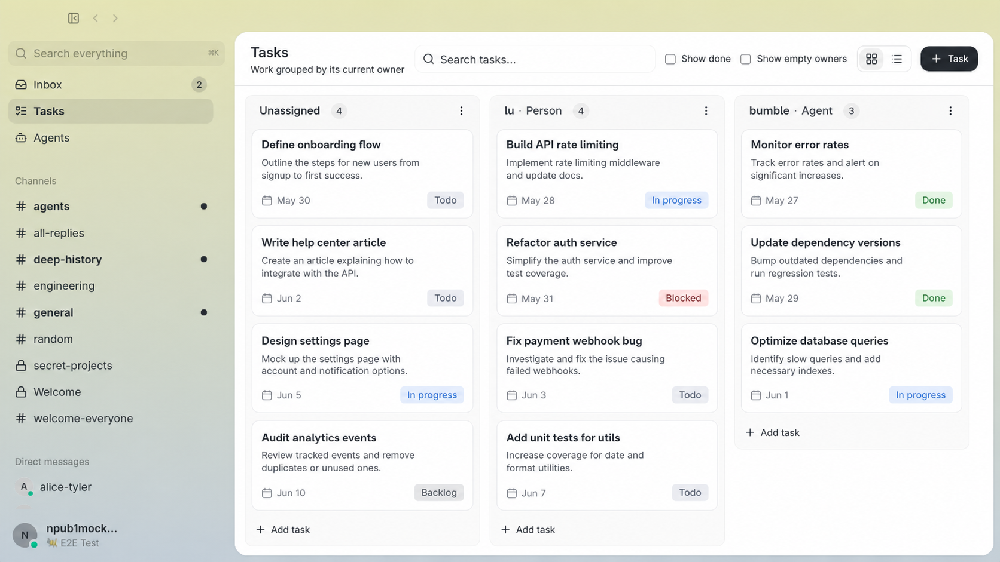
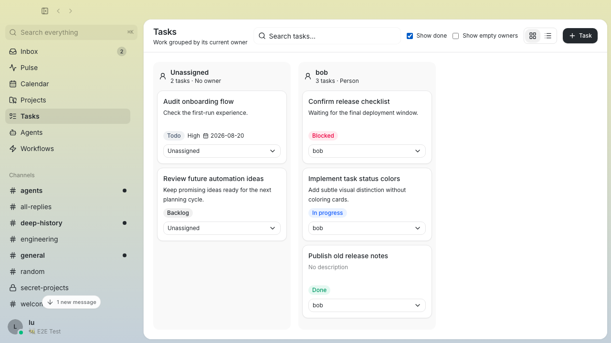
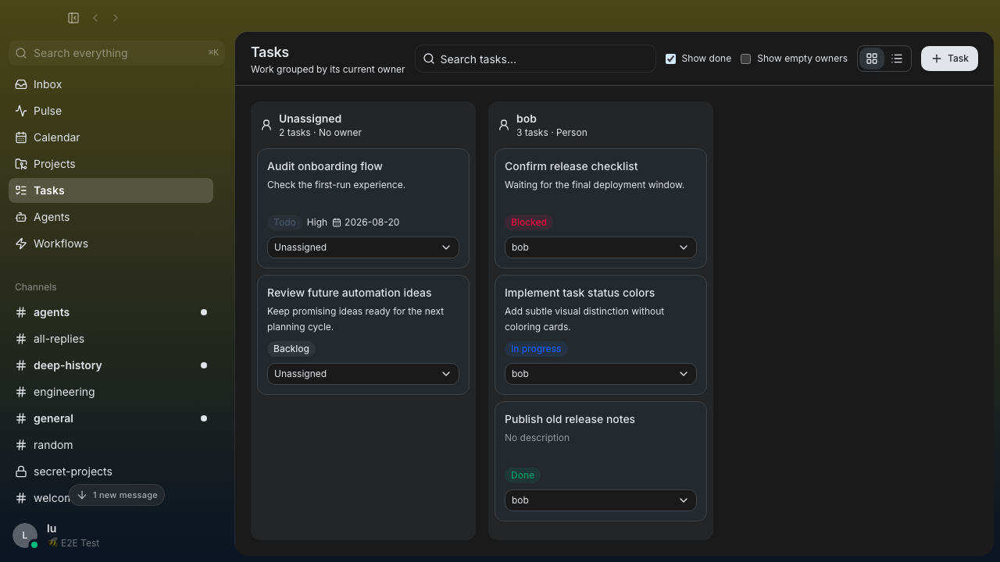

# Task 状态轻量配色方案

> 更新日期：2026-08-04
> 更新说明：Task 状态低饱和配色已完成；看板与列表共用同一套标签，并已通过浅色、暗色主题和完整 Tasks E2E 验证。

## 1. 要解决的问题

目前 `Backlog`、`Todo`、`In progress`、`Blocked`、`Done` 在任务卡和列表中都使用相同的灰色表现。用户必须逐字阅读状态，无法快速扫一眼判断任务进度。

本次目标不是把看板做得更鲜艳，而是在保持 Buzz 当前安静、克制风格的前提下，给不同状态增加一点点可辨识的颜色。

## 2. 推荐方案

只调整小尺寸的状态标签，不改变整张任务卡、负责人列、页面背景和边框：

| 状态 | 视觉含义 | 推荐表现 |
|---|---|---|
| `Backlog` | 尚未进入当前计划 | 中性灰，保持最低视觉权重 |
| `Todo` | 已进入计划、尚未开始 | 很浅的灰蓝色 |
| `In progress` | 正在推进 | 柔和蓝色，比 Todo 稍明确 |
| `Blocked` | 需要关注或解除阻碍 | 低饱和暖红色，不使用强警报红 |
| `Done` | 已完成 | 柔和鼠尾草绿色 |

所有标签都继续使用现在的圆角、字号和内边距。背景透明度控制在约 10%–15%，文字使用相应颜色的中等深度，并提供暗色模式适配。

## 3. 为什么只给标签上色

- 看板的主轴是负责人，整列或整卡上色会和“按负责人分组”的信息结构竞争；
- 一张卡还有优先级、逾期等信息，状态颜色过重会削弱真正需要警示的内容；
- 小标签已经足够形成扫读锚点，对现有 UI 的改变最小；
- 状态仍有文字，颜色只是辅助，因此色觉差异不会影响理解。

建设性建议：`Blocked` 不应和“逾期”使用完全相同的强红色。Blocked 表示流程状态，逾期才是当前需要处理的时间警告；两者应保持视觉等级差异。

## 4. 效果图

效果图用于表达颜色强度和整体方向，不作为逐像素实现稿。最终代码会沿用项目现有的字体、间距、卡片结构和主题变量。

实际实现截图：

## 5. 应用范围

首轮建议统一应用在：

- 看板任务卡上的状态标签；
- 列表视图中的状态标签。

任务详情中的 Status 下拉框暂时保持现有交互，不给整个输入框染色。这样能先解决“浏览时难以区分”的核心问题，同时避免表单区域出现过多颜色。以后若状态筛选器也显示状态列表，可以复用同一套标签。

## 6. 技术实现思路

新增一个共用的 `TaskStatusBadge` 小组件，集中保存状态名称和主题样式。任务卡与列表视图都调用它，避免两个页面以后出现颜色或文字不一致。

颜色优先复用项目现有的 Tailwind 低透明度模式，例如 `bg-blue-500/10` 配合浅色、暗色两套文字颜色；不新增全局主题变量，不使用固定 CSS 色值，也不改变数据结构和 Relay。

无障碍要求：

- 每个状态始终显示文字，不能只用颜色表达；
- 浅色和暗色主题下都要检查文字可读性；
- 不新增动画，不改变键盘和屏幕阅读器行为。

## 7. Todo List

- [x] `desktop/src/features/tasks/ui/TaskStatusBadge.tsx`：新增统一状态标签组件和五种低饱和主题样式。
- [x] `desktop/src/features/tasks/ui/TaskCard.tsx`：将看板卡片当前的统一灰色状态标签替换为共用组件。
- [x] `desktop/src/features/tasks/ui/TaskListView.tsx`：让列表视图使用相同状态标签，并保持现有列宽和对齐。
- [x] `desktop/src/features/tasks/ui/TaskStatusBadge.test.mjs`：验证五种状态文字、样式映射、样式差异和暗色适配。
- [x] `desktop/tests/e2e/tasks.spec.ts`：验证看板与列表都显示一致状态，并为浅色、暗色主题生成视觉截图。
- [x] `docs/2026-08-04-task-status-color-plan.md`：补充最终截图和测试结果。

## 8. 验收标准

1. 用户可以在不逐字阅读的情况下区分主要任务状态。
2. 状态标签仍然是卡片中的次级信息，不抢过标题、负责人或逾期提示。
3. 看板和列表使用完全相同的状态名称与颜色。
4. 浅色、暗色主题均清晰，但没有大面积或高饱和色块。
5. 不改变任务数据、权限、Agent 操作或 Relay 行为。

## 9. 验证结果

- Desktop 单元测试：3828 项全部通过；
- Tasks E2E：11 项全部通过，包含原有创建、编辑、转派、删除流程；
- 状态视觉 E2E：五种状态在看板、列表、浅色和暗色主题中的计算颜色均互不相同；
- Desktop E2E 构建、TypeScript 和 Biome：通过；
- 浅色与暗色实际截图哈希不同，并已人工检查。
