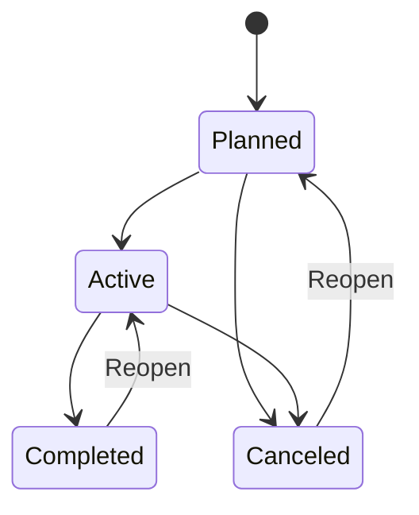
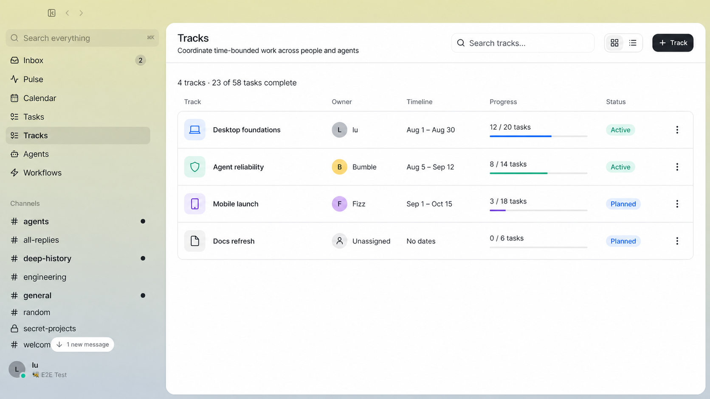

> 更新日期：2026-08-06
> 更新说明：完成 Track 成员、私有可见性与 Task 权限继承实现；Track 仅对 creator、owner、显式成员及代表 owner 行动的托管 Agent 可见，只有 owner 与 owner 名下 Agent 可以管理 Track，关联 Task 还必须通过 Track 可见性检查。

# Buzz Tracks 工作管理方案

## 1. 结论

Buzz 新增一级工作管理实体 `Track`。Track 表示一段有负责人、有明确时间范围、由多项 Task 共同推进的工作方向。

本方案不复用、改造或重新解释 Buzz 现有的代码仓库 Projects：

- 现有 Projects 继续表示 NIP-34 Repository、Issue、Pull Request、Commit 和 Review，其显示与隐藏仍由已有 feature gate 控制；
- 新 Tracks 是 community 内的通用工作管理能力；
- Task 当前的 `project` / `a` tag 继续只表示可选的代码仓库关联；
- Task 使用新的 `trackId` 归属 Track，一项 Task 最多属于一个 Track；
- Track 与代码仓库 Project 可以同时存在，二者没有继承或替代关系。

产品层级为：

```text
Community
├── Tracks
│   └── Track
│       └── Tasks
│           └── Executions
├── Tasks without a Track
└── Projects / Code repositories（现有能力，保持独立）
```

## 2. 用户问题与成功标准

### 2.1 用户问题

当前 Tasks 可以按负责人和状态组织，但缺少一个能够回答以下问题的长期容器：

- 这组任务共同服务于哪一段工作？
- 谁对整段工作负责？
- 计划何时开始、何时结束？
- 当前一共包含多少任务，完成了多少？
- 人和 Agent 分别负责哪些具体任务？

Tag 适合描述 Task 的多个横向属性，不适合作为唯一项目层级。一个 Task 可以同时拥有 `Desktop`、`Bug`、`P0` 等多个 Tag；如果直接按 Tag 分列，同一 Task 会重复出现在多个列中，拖拽和数量统计都会产生歧义。

### 2.2 成功标准

- 用户可以创建、查看、编辑和归档 Track；
- Track 有名称、描述、负责人、成员、开始日期、结束日期和生命周期状态；
- 一项 Task 可以选择归属一个 Track，也可以保持未归属；
- Tasks 看板可以按 Track 分组，每项 Task 只出现一次；
- Track 详情可以查看该 Track 下当前用户有权看到的 Tasks 和完成进度；
- 用户可以在 Task 创建和编辑时添加多个 Tag，并在 Tasks 面板按 Tag 筛选；
- 人和 Agent 都能通过同一 Relay 事件与 CLI 在权限范围内读取或操作 Track；
- Track 不向全部 community 成员公开，只对 creator、owner、Track members 和 owner 名下托管 Agent 可见；
- 关联 Track 的 Task 继承 Track 可见性：看不到 Track 的身份也看不到该 Task；
- Track 不读取、不写入现有 NIP-34 Projects 数据；
- 私密 Channel Task 不通过 Track 汇总泄露标题、数量或完成状态。

### 2.3 首版不做

- 不支持 Track 嵌套、子 Track 或无限层级；
- 不支持一项 Task 同时归属多个 Track；
- 不把 Track owner 自动变成所有 Task 的 assignee；
- 不增加成员管理员、编辑者等多级 Track 角色；显式 Track members 首版统一为只读；
- 不自动根据日期切换 Track 状态；
- 不把现有代码仓库 Project 转换为 Track；
- 不修改现有 Projects 的 feature gate、侧栏逻辑、底层模块或历史数据；
- 不实现按 Tag 分组；Tag 保持多值并用于筛选、搜索和卡片标识。

## 3. 产品模型

### 3.1 Track 字段

| 字段 | 产品含义 | 首版规则 |
| --- | --- | --- |
| `id` | 稳定 Track ID | UUID，创建后不可改变 |
| `name` | Track 名称 | 必填，去除首尾空白后 1–256 UTF-8 bytes |
| `description` | 工作目标与范围 | Markdown，可为空 |
| `owner` | 对整段工作负责的人或 Agent | 必填，创建时默认当前用户，可重新指派 |
| `members` | 可以发现和读取 Track 的人员或 Agent | 可为空、可多选、去重；成员首版只有读取权 |
| `startDate` | 计划开始日期 | 必填，使用 `YYYY-MM-DD`，不携带时区 |
| `endDate` | 目标结束日期 | 必填，必须不早于 `startDate` |
| `status` | 工作生命周期 | `planned`、`active`、`completed`、`canceled` |
| `archived` | 是否从日常工作区收起 | 独立布尔值；只允许归档 `completed` 或 `canceled` Track |
| `creator` | 创建 Track 的身份 | Relay 从 Create Command 作者写入 |
| `lastEditor` | 最近编辑身份 | Relay 从最新 Mutate Command 作者写入 |
| `createdAt` | 创建时间 | Relay 保留原始创建时间 |
| `updatedAt` | 最近更新时间 | 来自当前 Track State |

日期使用 date-only 字符串，而不是本地午夜 Unix timestamp，避免不同时区打开同一 Track 时发生日期偏移。

`owner agent` 在本方案中有严格定义：它是 Buzz 身份关系中 `agent_owner_pubkey == Track.owner` 的托管 Agent。它代表 owner 管理 Track，不需要重复加入 `members`；解除 Agent 与 owner 的归属关系后，继承的可见权和操作权立即失效。

### 3.2 Track、Task 与 Tag

| 概念 | 数量关系 | 负责解决的问题 |
| --- | --- | --- |
| Track | 一个 Task 最多属于一个 | 工作归属、负责人、周期和总体进度 |
| Task | 一个 Track 包含零到多个 | 具体可执行工作及单一 assignee |
| Tag | 一个 Task 可以有多个 | 横向属性、筛选、搜索和轻量标识 |
| Repository | 一个 Task 仍可选关联一个 | 代码仓库上下文，不代表工作归属 |

Track owner 和 Task assignee 是两种不同责任：

- Track owner 对整体范围、时间和推进负责；
- Task assignee 对某一项具体工作负责；
- 将 Agent 设为 Track owner 不会自动启动 Agent；
- 将 Task 移入 Track 不会改变 Task assignee、状态或 Channel 可见性。

Task 关联 Track 后采用权限交集，而不是权限并集：

```text
canReadTask = existingTaskAccess AND canReadTrack
```

- Track 可见性是关联 Task 的额外门槛；看不到 Track，即使原本能访问 Task 所在 Channel，也不能读取该 Task；
- Track member 身份不会绕过 Task 自身或私密 Channel 权限；能看到 Track，不代表能看到 Track 下全部 Tasks；
- 未关联 Track 的 Task 完全沿用现有可见性；
- Task 清除 Track 归属后恢复为只受现有 Task/Channel 权限控制。

Tag 是 Task 自身的多值属性，不属于 Track：

- Task 创建和编辑都可以添加、移除多个 Tag；
- Tag 使用 chip 形式显示，单个值去除首尾空白后为 1–64 UTF-8 bytes；
- 同一 Task 不保存完全相同的重复 Tag；
- Tasks 面板提供 Tag 多选筛选，选择多个 Tag 时采用“匹配任意一个”的 OR 语义；
- 当前筛选条件必须以可见 chip 呈现并可单独清除；
- `Group by` 只提供 `Assignee`、`Status` 和 `Track`，不提供 `Tag`；
- Task 卡片最多展示两个 Tag，更多内容显示 `+N`，完整列表在 Task 详情中查看。

### 3.3 生命周期



日期只提供计划边界，不自动驱动状态。用户可以提前启动、延期结束、取消或重新打开 Track，所有变化保留真实操作者。

归档不是工作状态，而是列表可见性：

```text
status: completed | canceled
archived: false ──Archive──► true ──Restore──► false
```

- `planned` 和 `active` 不能直接归档，必须先完成或取消；
- Archive 只把 Track 从日常列表收起，不改变 `status`；
- Restore 恢复原状态，不自动变成 `active`；
- 归档和恢复都通过 Track Mutate Command 保留真实操作者与历史。

## 4. 信息架构与 UI

### 4.1 导航位置

`Tracks` 作为新的一级入口，放在主侧栏 `Tasks` 之后、`Agents` 之前。现有代码仓库 `Projects` 是否出现继续由已有 feature gate 决定；示意结构按该开关关闭时展示：

```text
Inbox
Pulse
Calendar
Tasks
Tracks      ← 新工作管理能力
Agents
Workflows
```

选择一级入口的原因：

- Track 是管理范围，Task 是执行单元，二者是相邻但不同的日常工作面；
- Track owner 需要不进入某个 Task 就能看到整体周期和进度；
- 避免在已有应用侧栏内再永久嵌套一条占宽的 Track 子侧栏；
- `Tracks` 名称已经避开现有 `Projects` 的产品和路由冲突；
- Tracks 不读取 Projects feature gate，也不迁移、不删除 repository events。

首版路由：

```text
/tracks                 Track 列表
/tracks/$trackId        Track 详情及所属 Tasks
/tasks?group=track      全部 Tasks 按 Track 分组
/tasks?track=$trackId   从 Track 返回全局 Tasks 时保留 Track 筛选
```

### 4.2 Tracks 列表示意图



该图使用 Buzz 当前 Tasks 的浅色界面作为直接视觉参考，用于确认布局、信息密度和入口位置，不是逐像素实现稿。实现时必须继续使用项目现有的主题变量、Button、Input、Badge、Avatar、Tooltip、Dialog 和 rem 字号 token，不复制图片中的固定颜色值。

示意图生成早于归档找回规则确认；正式实现需在标题与汇总行之间加入 `Current / Completed / Archived`，其余布局保持不变。

列表页信息结构：

- 标题与一句话说明；
- 标题下提供始终可见的 `Current / Completed / Archived` 范围切换；
- 搜索、列表/网格视图和 `+ Track`；
- 汇总当前可见的 Track 数和 Task 完成数；
- 每行展示名称、owner、日期范围、可见 Task 进度和状态；
- Current 行尾菜单提供编辑；Completed 行尾菜单提供编辑与归档；Archived 行提供查看与 Restore；
- 点击整行进入 Track 详情；
- Current 默认排序为 `active` → `planned`，同状态按 `endDate` 升序；Completed 按 `updatedAt` 降序；Archived 按归档时间降序。

范围切换不能藏在二级筛选菜单中：

```text
Tracks
[Current] [Completed] [Archived]      Search tracks…      [+ Track]
```

- `Current`：未归档的 `planned`、`active`；
- `Completed`：未归档的 `completed`、`canceled`；
- `Archived`：所有已归档 Track，并保留其原始状态；
- 搜索只作用于当前范围，范围切换后保留搜索词；
- 不提供会把归档内容重新混入日常工作区的模糊 `All` 默认视图。

首版可以只交付列表视图；网格切换按钮只有在网格视图一并实现时才显示，不能放置无行为控件。

### 4.3 Track 详情

```text
┌──────────────────────────────────────────────────────────────────────┐
│ ← Tracks   Desktop foundations                       [•••] [+ Task] │
│            Build a reliable desktop foundation                      │
│                                                                      │
│ Owner  lu     Aug 1 – Aug 30     Active     12 / 20 tasks           │
│ ━━━━━━━━━━━━━━━━━━━━━━━━━━━━━━━━━━━━━━━ 60%                           │
├──────────────────────────────────────────────────────────────────────┤
│ [Board] [List]        Group by [Status ▼]      Search tasks…         │
├──────────────────────────────────────────────────────────────────────┤
│ Backlog              In progress             Done                   │
│ ┌───────────────┐    ┌───────────────┐       ┌───────────────┐      │
│ │ Task card     │    │ Task card     │       │ Task card     │      │
│ └───────────────┘    └───────────────┘       └───────────────┘      │
└──────────────────────────────────────────────────────────────────────┘
```

Track 详情复用现有 TaskBoardView / TaskListView 的视觉语言，但数据范围固定为当前 Track。详情顶部只展示 Track 元数据和从当前用户可见 Tasks 派生的进度，不建立第二套任务卡片。

打开已归档 Track 的深链时仍显示详情，不返回 404。详情顶部增加清晰提示：

```text
Archived Track
This track is hidden from Current and Completed views.     [Restore Track]
```

从历史 Task 点击已归档 Track 名称时也进入这个只读详情。只有具备编辑权限的用户看到 `Restore Track`。

### 4.4 创建与编辑 Track

创建使用与现有 Buzz chooser/dialog 一致的居中 Dialog：

```text
Create Track

Name          [ Desktop foundations                  ]
Description   [ What outcome should this track reach? ]
Owner         [ lu ▼                                  ]
Members       [ Alice × ] [ Design Agent × ] [ Add… ▼ ]
Start date    [ 2026-08-01 ]
End date      [ 2026-08-30 ]
Status        [ Planned ▼ ]

                                  [Cancel] [Create Track]
```

交互规则：

- owner 默认当前用户，但保存前仍可选择 Person 或 Agent；
- members 可以选择当前 community 中的 Person 或 Agent，owner 不需要重复加入；
- creator、owner、members 均可读取 Track，但 members 与 creator 不因此获得编辑权；
- 只有 owner 或 owner 名下托管 Agent 显示编辑、成员管理、归档与恢复操作；
- 开始和结束日期均为必填；
- 结束日期早于开始日期时在字段下方就地提示，不提交事件；
- 创建中禁用重复提交；
- Relay 拒绝、并发冲突或权限变化时保留用户输入并显示可恢复错误；
- 编辑 Track 使用相同字段，更新通过 `previous` State event ID 做乐观并发。

归档成功后显示可撤销反馈：

```text
“Desktop foundations” was archived.    [Undo]
```

`Undo` 在 toast 可见期间执行一次 Restore；toast 消失后仍可从 Tracks → Archived 找回。

### 4.5 Task 中的 Track 与 Tag

Task 创建和详情面板增加单选字段：

```text
Track
[ No track / Desktop foundations / Agent reliability ▼ ]

Tags
[ Desktop × ] [ Bug × ] [ Add tag…                    ]
```

规则：

- 一个 Task 只能选择一个 Track；
- 归档 Track 不出现在新选择列表中，但已有归属继续显示；
- 清除 Track 只清除归属，不改变 Task 的 repository、Channel、Tag、assignee 或 status；
- Task 卡片在空间允许时显示 Track 名称；窄卡片优先保留标题、状态、优先级和截止时间；
- Tasks 页面 `Group by` 增加 `Track`；
- `No track` 是固定分组；
- 将 Task 拖到另一个 Track 列表示替换 `trackId`，拖到 `No track` 表示清除；
- Track 分组不会复制 Task，因此列数量与真实 Task 数一致。

Tasks 顶部保留独立的 Tag 筛选器：

```text
Filter by tags
[ Desktop × ] [ P0 × ] [ Select tags… ▼ ]
```

- 筛选只影响当前 Board / List 的可见 Tasks，不改变 Task 数据；
- 多个已选 Tag 使用 OR 语义：Task 匹配任意一个已选 Tag 即可显示；
- Tag 筛选可以与状态、Track、Channel、搜索和 `Show done` 组合；
- Tag 不进入 `Group by` 菜单，因此一项 Task 在任何分组视图中只出现一次；
- 清除筛选后恢复当前权限范围内的全部 Tasks。

### 4.6 状态与响应式要求

Tracks 列表与详情必须覆盖：

- loading skeleton；
- 首次空状态，并提供 `Create Track` 主操作；
- 搜索无结果状态；
- Relay 加载失败与 Retry；
- 无权限编辑时的只读状态；
- owner 或关联 Agent 被归档后的历史显示；
- Track 已归档但仍有 Task 的状态；
- Current / Completed / Archived 三个范围各自的 empty state；
- Archived 列表的 Restore、深链提示和归档后的 Undo；
- 长名称、长 owner 名称、跨年日期和大量 Tasks；
- 窄窗口下折叠次要列，保留名称、状态、owner 和进度；
- 浅色、深色以及 Desktop Cmd +/- 缩放。

## 5. 数据与协议设计

### 5.1 独立事件，不复用 NIP-34

Track 延续 Tasks 的 Command + Relay-signed State 模型：

| 候选 Kind | 名称 | 产品含义 | 签名者 |
| --- | --- | --- | --- |
| `42510` | `KIND_TRACK_CREATE` | 创建 Track | 实际操作的人或 Agent |
| `42511` | `KIND_TRACK_MUTATE` | 编辑、转派 owner、改状态、归档或恢复 | 实际操作的人或 Agent |
| `30510` | `KIND_TRACK_STATE` | Track 当前状态，`d=<track-id>` | 当前 community Relay |

这些编号当前未被 Buzz 的 `ALL_KINDS` 使用；实施前仍需再次核对仓库和外部 kind registry。Track 不发布 kind `30617`，也不生成 repository coordinate。

推荐 Track State 字段：

| 字段 | Event 表达 |
| --- | --- |
| 稳定 ID | `d=<track-uuid>` |
| 名称 | `title=<name>` |
| 描述 | `content` |
| owner | 单个 `p=<pubkey>`，可带 identity type marker |
| 成员 | 零到多个 `member=<pubkey>`，每个身份只出现一次 |
| 开始日期 | `start_date=YYYY-MM-DD` |
| 结束日期 | `end_date=YYYY-MM-DD` |
| 状态 | `t=track-status:<value>` |
| 归档 | `archived=true|false` |
| 创建者 | `creator=<pubkey>` |
| 最近编辑者 | `last_editor=<pubkey>` |
| 来源命令 | `source_event=<command-event-id>` |
| 乐观并发 | Mutate Command 使用 `previous=<state-event-id>` 和明确 marker 的 `e` tag |

Task State 与 Task Command 新增至多一个：

```text
["t", "track-id:<track-uuid>"]
```

使用带命名空间的标准 `t` tag，避免占用现有 `a` repository tag，也能沿用当前 `#t` 查询和 SQL pushdown。清除使用：

```text
["clear", "track"]
```

Task Tag 沿用已经存在的协议表达，不新增 Track 专属 Tag 机制：

```text
["t", "label:<value>"]
```

一次 Task mutation 修改 Tag 时继续采用完整替换语义：先携带 `["clear", "labels"]`，再写入当前完整 Tag 集合。未显式修改 Tag 的旧客户端 patch 必须保留 State 中已有 Tag。

### 5.2 原子性与并发

- Track Create/Mutate 必须进入 Relay 写前 `command_executor`，不能依赖 post-storage side effect；
- 数据库在同一事务中保存真实签名 Command、替换旧 Track State、写入 Relay-signed 新 State；
- Mutate 必须携带客户端读到的 `previous` Track State event ID；
- head 不一致返回现有 write conflict 语义，不静默覆盖；
- 相同 Command event ID 重试幂等成功；
- 重复 Track UUID create 返回明确冲突；
- 只有事务提交成功后才 fan-out Track State；
- Track State fan-out 必须逐连接执行 Track 可见性检查，不得广播给全部 community 连接；
- Task 关联 Track 的修改继续通过 Task 自己的 CAS 事务完成，不与 Track State 双写。

### 5.3 引用完整性

- Task 设置 `trackId` 时，Relay 必须确认该 Track 属于同一 community 且未归档；
- Task 设置或替换 `trackId` 时，操作者必须对目标 Track 有读取权；已知 UUID 不能绕过 Track ACL；
- 未知、跨 community 或已归档 Track 拒绝新关联；
- Track 归档不会改写已有 Tasks，避免一次操作隐式产生大量事件；
- 已有关联的 Task 可以继续编辑其他字段，也可以移出归档 Track；
- Track 恢复后可以再次接收 Task；
- Relay 只允许 `completed` 或 `canceled` Track 从 `archived=false` 变为 `true`；
- Restore 只把 `archived` 改回 `false`，保留归档前的 `status`；
- 首版不永久删除 Track，避免留下无法解释的 Task 引用。
- 读取已关联 Task 时若 Track 不存在、跨 community 或对查看者不可见，Relay 必须 fail closed，不返回 Task；
- Track 的 owner、members 或 owner Agent 关系变化后，关联 Tasks 的有效可见范围随当前 Track ACL 变化，不依赖批量改写 Task State。

### 5.4 可见性与操作权限

可见性和操作权必须分开判断，不能用“能读取”推导“能修改”。

Track 的有效可见身份只有：

- Track `creator`；
- 当前 Track `owner`；
- `members` 中显式列出的 Person 或 Agent；
- owner 名下当前有效的托管 Agent。该身份是 owner 的动态受托身份，不写入 `members`。

除此之外的普通 community 成员、其他成员的 Agent 以及 community 管理员均不能发现或读取该 Track。按 ID 查询同样 fail closed，不返回可用于判断 Track 是否存在的元数据。Track Create/Mutate Command 与 Track State 都属于同一 ACL，不能通过查询历史 Command 绕过。WebSocket REQ、HTTP `/query`、`/count`、实时 fan-out 和任何搜索路径必须执行同一可见性规则，防止列表隐藏但深链、COUNT、历史或订阅仍泄露。

已有 Track 的管理操作只允许：

- 当前 Track `owner`；
- owner 名下当前有效的托管 Agent。

管理操作包括编辑字段、增删成员、转派 owner、改变状态、归档和恢复。Track `creator` 若不是 owner，则仅保留读取权；显式 members 只有读取权；community owner/admin 也没有越权编辑例外。转派 owner 后，旧 owner 及其 Agents 立即失去管理权，除非旧 owner 仍是 creator/member；新 owner 及其 Agents 立即获得管理权和可见性。

创建 Track 仍允许当前 community 成员执行；创建时 creator 默认也是 owner。若创建者在创建时指定其他 owner，创建成功后只以 creator 身份保留读取权，不能继续修改。指定 owner 和 members 时必须验证它们是当前 community 的有效 Person 或 Agent 身份。

Track owner 身份不会继承 Task 或私密 Channel 权限。Task 移入或移出 Track 仍遵守现有 Task 编辑权限；同时，操作者必须对目标 Track 有读取权，不能通过已知 UUID 把 Task 关联到不可见 Track。

关联 Task 的读取使用交集授权：先通过现有 Task、Channel、作者等访问检查，再根据当前 Task State 的 `track-id` 查询当前 Track State 并执行 Track ACL。任一检查失败都不返回 Task。该规则必须覆盖 Task State、Task Command、Execution 等可反查 Task 的事件，以及 WS REQ、HTTP query/count、搜索结果、实时 fan-out、Task get/list 和任何聚合路径；不能通过读取历史 Task Command 绕过当前 Track ACL。

### 5.5 隐私与进度

Track State 虽然不使用 Channel `h` tag，但属于 Track ACL 保护的私有 community 元数据，不是 community-global 可读数据。Task 仍可通过 `h` tag 归属于私密 Channel。

因此首版进度必须从“同时通过 Task/Channel 与 Track ACL 的 Tasks”派生：

```text
visible progress = visible done tasks / all visible tasks
```

Relay 和客户端不得向未通过任一权限层的用户返回 Task 本体、全量 Task 数、隐藏标题或隐藏完成数。COUNT、分页 cursor、搜索命中数和分组数量也不得泄露被 Track ACL 隐藏的 Task。UI 使用“Visible tasks”语义，不能暗示这是所有成员都一致的绝对总数。

客户端只能用 Relay 已授权返回的 Track 集合渲染 Track 名称、选择器、筛选器和分组。由于关联 Task 必须继承 Track 可见性，不允许再向无权读取 Track 的身份返回 Task 后用 `Restricted track` 占位；Task 本身必须从查询、搜索、计数、分组和实时更新中消失。

## 6. CLI 与 Agent 契约

Agent-facing 操作加入 `buzz-cli`：

```text
buzz tracks create --name <text> --owner <me|pubkey> \
  --start-date <YYYY-MM-DD> --end-date <YYYY-MM-DD> \
  [--description <text>] [--member <pubkey>]...
buzz tracks list [--scope <current|completed|archived>] [--status <value>] [--owner <pubkey>]
buzz tracks get --id <uuid>
buzz tracks update --id <uuid> --expected-event <event-id> \
  [field patches] [--member <pubkey>]... [--clear-members]
buzz tracks archive --id <uuid> --expected-event <event-id>
buzz tracks restore --id <uuid> --expected-event <event-id>

buzz tasks create ... [--track <uuid>]
buzz tasks update ... [--track <uuid> | --clear-track]
buzz tasks list ... [--track <uuid>]
```

`--member` 在 create 中追加初始成员，在 update 中与现有 labels patch 风格一致，代表完整替换成员集合；`--clear-members` 明确清空成员。所有写操作返回现有统一结构并增加实体 ID / State ID。Agent 不需要自行聚合 Track Command 历史即可读取当前状态。owner 名下 Agent 使用自己的签名和 pubkey 操作，Relay 动态验证 owner 关系，不冒充 owner。

## 7. 兼容性与迁移

- 这是 additive change，不修改现有 Task kind 和 NIP-34 Project kind；
- 旧 Task 没有 `track-id:` 时解析为 `trackId=null`；
- 新客户端继续解析旧 Task；旧客户端忽略新 `t=track-id:` tag，仍可显示和编辑其他字段；
- 旧客户端更新 Task 时，Relay 必须沿用当前 State 中未被显式修改的 Track 归属，不能因 patch 不认识 Track 就清空；
- 现有 Task `project` 字段和 `a` tag 保持 repository 语义；
- 不需要关系型 schema migration，Track Command / State 继续落在 `events`；
- 如果后续规模证明通用事件索引不足，再增加可重建投影，不在首版维护双写表。

## 8. 测试与验收

### 8.1 协议与 Relay

- Track create、mutate、archive 和 restore，且 Restore 保留原状态；
- owner、日期范围、状态和 UUID 非法输入；
- 重复 create、幂等重试和旧 head 冲突；
- creator、owner、owner 名下 Agent、显式 member、管理员与无关成员的读写权限矩阵；
- WS REQ、HTTP query/count、搜索、深链和实时 fan-out 使用相同 Track 可见性规则；
- 关联 Task 在 WS、HTTP、COUNT、搜索、深链和实时 fan-out 中同时通过 Task/Channel 与 Track ACL；
- owner 与 Agent 归属关系解除后权限立即失效，转派 owner 后新旧 owner 权限立即切换；
- member 完整替换、清空、去重及无效 community 身份拒绝；
- Person / Agent owner 有效性；
- community 隔离以及相同 UUID 跨 community；
- Task 设置、替换和清除 Track；
- 未知、跨 community、归档 Track 拒绝关联；
- Track 归档不改写或删除已有 Tasks；
- 看不到 Track 的身份无法通过 Task get/list、Channel 查询、搜索、COUNT 或实时订阅发现关联 Task；
- Track member 仍不能读取其无权访问的私密 Channel Task，验证权限交集而非权限并集；
- 未关联 Track 与清除 Track 后的 Task 保持现有可见性；
- fan-out 只发生在事务提交后。

### 8.2 Desktop

- Tracks 侧栏入口、Current / Completed / Archived、各范围空状态、错误重试和深链；
- 创建和编辑表单校验；
- Track owner、members、日期、状态和进度展示；
- creator/member 只读，owner 与 owner 名下 Agent 可编辑；无权身份看不到 Track 及其关联 Tasks 的列表、深链、数量和实时更新；
- Track 详情 Board / List 只显示该 Track 的可见 Tasks；
- Task 创建与详情可以选择、替换和清除 Track；
- Task 创建与详情可以添加、移除和保存多个 Tag；
- Tag 多选筛选采用 OR 语义，并能与其他筛选条件组合；
- Board / List 卡片显示最多两个 Tag 和 `+N`；
- Tasks 按 Track 分组，包含 `No track`；
- `Group by` 不出现 Tag 选项；
- Track 分组拖拽成功、Relay 拒绝回滚和键盘可访问替代路径；
- 归档 Track 在选择器中隐藏但历史 Task 仍正确显示；
- 已归档 Track 可从 Archived 列表、历史 Task 深链和 Undo 三条路径找回；
- 长文本、窄窗口、浅色、深色与缩放；
- 截图使用 E2E mock bridge，等待动画完成并检查 PNG hash 不重复。

### 8.3 成功验收场景

1. 用户创建 `Desktop foundations`，指定 owner、Track members、8 月 1 日开始、8 月 30 日结束；
2. 用户创建或编辑 Task，将其归入该 Track；
3. Tracks 列表即时更新可见 Task 进度；
4. 用户进入 Track 详情，按状态查看和拖动 Tasks；
5. 用户回到 Tasks 页面，按 Track 分组时该 Task 只出现一次；
6. creator、owner、members 能读取 Track，无关 community 成员在列表、深链、COUNT 和订阅中均无法发现它；
7. owner 名下 Agent 通过 CLI 更新 Track，普通 member、creator 和管理员的相同写操作被拒绝；
8. Agent 与 owner 解绑后立即失去 Track、关联 Tasks 的访问权及 Track 操作权；
9. 能访问 Task 所在 Channel 但看不到 Track 的成员，无法通过 Task 列表、搜索、COUNT 或订阅发现该 Task；
10. Track member 若无 Task 所在私密 Channel 权限，同样看不到该 Task；
11. 用户完成 Track 后将其归档，随后可通过 Undo 或 Archived → Restore 恢复，原 `completed` 状态不变。

## 9. 实施顺序

1. 扩展 Track 领域与 SDK，加入 members 的完整替换语义；
2. 先实现并测试 Relay 统一 Track ACL 与关联 Task 权限交集，再接入 WS、HTTP、COUNT、搜索和 fan-out；
3. 收紧 Track mutation 和 Task 关联权限，动态验证 owner Agent 关系；
4. 扩展 `buzz tracks`、Agent 提示词与 live-testing runbook；
5. 增加 Desktop members 编辑、只读权限态与 Restricted track 降级显示；
6. 完成 unit、integration、E2E 与 wiki 更新；
7. 运行 `just ci`，提交 signed-off commit，并按鹿鹿子大王要求保留在功能分支，不合并回 `dev`。

## 10. Todolist

以下清单是实施范围预估；每个 Todo 只对应一个文件。得到鹿鹿子大王对本方案的确认后才能开始改代码。

### 协议与领域

- [x] `crates/buzz-core/src/kind.rs`：登记 Track Command / State kind，并加入分类与重复检测。
- [x] `crates/buzz-core/src/track.rs`：定义 TrackStatus、独立 archived 属性、日期、名称、owner 与 Track ID 校验。
- [x] `crates/buzz-core/src/lib.rs`：导出 Track 领域模块。
- [x] `crates/buzz-sdk/src/lib.rs`：增加 TrackCreateInput / TrackMutateInput，并为 Task input 增加独立 track 字段。
- [x] `crates/buzz-sdk/src/builders.rs`：构建和测试 Track Command，以及 Task `track-id:` / `clear track` tags。

### Relay 与数据库

- [x] `crates/buzz-db/src/tracks.rs`：实现 Track Command 与当前 State 的原子事务及并发测试。
- [x] `crates/buzz-db/src/lib.rs`：暴露 Track 原子写入接口。
- [x] `crates/buzz-relay/src/handlers/command_executor.rs`：校验、派生和发布 Track State，并验证 Task 的 Track 引用。
- [x] `crates/buzz-relay/src/handlers/ingest.rs`：为 Track Command 指定 MessagesWrite scope 并接入命令执行链。
- [x] `crates/buzz-test-client/tests/e2e_relay.rs`：覆盖 Track 协议、权限、community 隔离和 Task 关联 E2E。

### CLI 与 Agent

- [x] `crates/buzz-cli/src/lib.rs`：声明 `tracks` 子命令、参数和 Task track 参数。
- [x] `crates/buzz-cli/src/commands/mod.rs`：注册 Tracks command module。
- [x] `crates/buzz-cli/src/commands/tracks.rs`：实现 Track create/list/get/update/archive/restore 和 scope 查询。
- [x] `crates/buzz-cli/src/commands/tasks.rs`：解析、输出、筛选和更新 Task trackId。
- [x] `crates/buzz-cli/TESTING.md`：补充 Track CLI live-testing runbook。

### Desktop 数据层

- [x] `desktop/src/shared/constants/kinds.ts`：增加 Track kind 常量。
- [x] `desktop/src/features/tracks/types.ts`：定义 Track、TrackStatus、TrackDraft 和 TrackPatch。
- [x] `desktop/src/features/tracks/lib/trackEvents.ts`：解析 Track State 并构建 Track Command。
- [x] `desktop/src/features/tracks/lib/trackEvents.test.mjs`：覆盖 Track 事件解析和构建。
- [x] `desktop/src/features/tracks/hooks.ts`：实现 Track 查询、订阅、创建和更新 mutations。
- [x] `desktop/src/features/tracks/lib/trackProgress.ts`：从当前用户可见 Tasks 派生进度与排序。
- [x] `desktop/src/features/tracks/lib/trackProgress.test.mjs`：覆盖可见进度、排序和归档行为。

### Desktop Tracks UI

- [x] `desktop/src/features/tracks/ui/TracksScreen.tsx`：实现 Current / Completed / Archived 范围、搜索、空状态和列表页状态编排。
- [x] `desktop/src/features/tracks/ui/TrackList.tsx`：实现紧凑列表、响应式列、Archive、Restore 和 Undo。
- [x] `desktop/src/features/tracks/ui/TrackEditorDialog.tsx`：实现创建与编辑表单及日期校验。
- [x] `desktop/src/features/tracks/ui/TrackDetailScreen.tsx`：实现 Track 元数据、进度、所属 Task 看板/列表和归档深链 Restore 提示。
- [x] `desktop/src/app/routes/tracks.tsx`：注册 Tracks 列表路由。
- [x] `desktop/src/app/routes/tracks.$trackId.tsx`：注册 Track 详情深链路由。
- [x] `desktop/src/app/routes.ts`：声明 Tracks 文件路由。
- [x] `desktop/src/app/routeTree.gen.ts`：生成 Tracks 列表和详情的类型安全路由树。
- [x] `desktop/src/app/navigation/useAppNavigation.ts`：增加 goTracks / goTrack 导航。
- [x] `desktop/src/app/AppShell.helpers.ts`：识别 Tracks 路由和侧栏选中态。
- [x] `desktop/src/features/sidebar/ui/AppSidebarPinnedHeader.tsx`：保留 Projects 原有 feature gate，并在 Tasks 后增加 Tracks 入口。
- [x] `desktop/src/features/sidebar/ui/AppSidebar.tsx`：传递 Tracks 导航回调和选中态。
- [x] `desktop/src/app/AppShell.tsx`：把 Tracks 导航接入 AppShell。

### Desktop Tasks 集成

- [x] `desktop/src/features/tasks/types.ts`：为 Task / Draft / Patch 增加 trackId 与 labels，并扩展 Track 分组类型。
- [x] `desktop/src/features/tasks/lib/taskEvents.ts`：解析与构建单一 `track-id:` 关联及完整 Tag 集合。
- [x] `desktop/src/features/tasks/lib/taskEvents.test.mjs`：覆盖 Track 归属、多 Tag 去重、字节限制与清除语义。
- [x] `desktop/src/features/tasks/lib/taskBoard.ts`：增加 Track 筛选、排序、分组、`No track` 和 Tag OR 筛选。
- [x] `desktop/src/features/tasks/lib/taskBoard.test.mjs`：覆盖 Track 分组唯一性、Tag OR 语义与组合筛选。
- [x] `desktop/src/features/tasks/ui/TaskTagInput.tsx`：实现多 Tag chip 编辑、建议、去重和移除交互。
- [x] `desktop/src/features/tasks/ui/TaskTagFilter.tsx`：实现 Tag 多选筛选、已选 chip 和清除操作。
- [x] `desktop/src/features/tasks/ui/TaskTrackFilter.tsx`：实现按 Track 筛选和深链筛选清除操作。
- [x] `desktop/src/features/tasks/ui/TasksScreen.tsx`：加载 Tracks，增加 Group by Track，并接入 Tag 多选筛选。
- [x] `desktop/src/features/tasks/ui/CreateTaskDialog.tsx`：增加 Track 单选与多 Tag 编辑字段。
- [x] `desktop/src/features/tasks/ui/TaskDetailPanel.tsx`：支持查看、替换和清除 Track，以及编辑多个 Tag。
- [x] `desktop/src/features/tasks/ui/TaskBoardView.tsx`：定义 Track 分组拖拽语义。
- [x] `desktop/src/features/tasks/ui/TaskCard.tsx`：按空间优先级展示 Track 名称、最多两个 Tag 和 `+N`。
- [x] `desktop/src/features/tasks/ui/TaskListView.tsx`：增加 Track 列与紧凑 Tag 信息。

### E2E 与文档

- [x] `desktop/tests/e2e/tracks.spec.ts`：覆盖范围切换、创建、详情、Task 归属、Archive、Undo、Restore、深链和截图状态。
- [x] `desktop/tests/helpers/bridge.ts`：为 Tracks E2E 暴露 Track State fixture。
- [x] `desktop/src/testing/e2eBridge.ts`：模拟 Track 查询、创建、更新、归档与恢复事件流。
- [x] `desktop/playwright.config.ts`：将 Tracks E2E 注册进 smoke 项目。
- [x] `wiki/concepts.md`：增加 Track，并明确 Track / Task / Tag / Repository Project 边界。
- [x] `wiki/modules.md`：登记 Tracks vertical slice 和证据入口。
- [x] `wiki/index.md`：在 Wiki 索引中登记 Tracks 概念和模块入口。
- [x] `docs/assets/tracks-ui-concept-2026-08-06.png`：保存与 Buzz 整体 UI 一致的 Tracks 示意图。
- [x] `docs/2026-08-06-tracks-work-management-plan.md`：记录本方案、UI、协议、测试和实施清单。

### Track 成员与权限补充（已实现）

- [x] `crates/buzz-core/src/track.rs`：增加 Track member 集合校验、去重和直接可见身份判断。
- [x] `crates/buzz-core/src/filter.rs`：把 Track Command/State 与可反查关联 Task 的事件纳入 fail-closed 受限事件识别，防止通用查询旁路。
- [x] `crates/buzz-sdk/src/lib.rs`：为 Track create/mutate input 增加 members 与 clear-members patch 语义。
- [x] `crates/buzz-sdk/src/builders.rs`：构建、替换和清空 Track member tags，并补充 builder 测试。
- [x] `crates/buzz-relay/src/handlers/command_executor.rs`：限制 mutation 为 owner/owner Agent，校验成员身份，并要求 Task 操作者可读目标 Track。
- [x] `crates/buzz-relay/src/handlers/req.rs`：在 WebSocket 历史查询与搜索中应用 Track ACL，并按交集过滤关联 Task。
- [x] `crates/buzz-relay/src/handlers/count.rs`：确保 Track 与关联 Task COUNT 采用相同授权结果且不泄露存在性。
- [x] `crates/buzz-relay/src/handlers/event.rs`：按连接过滤 Track State 和关联 Task 的实时 fan-out，禁止 community 全广播。
- [x] `crates/buzz-relay/src/api/bridge.rs`：为 HTTP query/count/search/feed/thread 增加等价 Track ACL 与关联 Task 权限交集。
- [x] `crates/buzz-relay/src/push_runtime.rs`：在移动端唤醒匹配前执行 Track 与关联 Task ACL。
- [x] `crates/buzz-test-client/tests/e2e_relay.rs`：覆盖成员读取、creator/member/admin 禁写、owner Agent 读写、解绑、owner 转派及关联 Task 权限交集。
- [x] `crates/buzz-cli/src/lib.rs`：为 Track create/update 声明重复 `--member` 与 `--clear-members` 参数。
- [x] `crates/buzz-cli/src/commands/tracks.rs`：解析和输出 members，并实现完整替换与清空。
- [x] `crates/buzz-cli/TESTING.md`：增加 Track 私有可见性、成员和 owner Agent live-testing 流程。
- [x] `crates/buzz-acp/src/base_prompt.md`：明确 Agent 可用的 Tracks 命令及 owner Agent 权限边界。
- [x] `desktop/src/features/tracks/types.ts`：为 Track、draft 与 patch 增加 members，并表达 canRead/canManage 权限。
- [x] `desktop/src/features/tracks/lib/trackEvents.ts`：解析和构建 members tags 与清空语义。
- [x] `desktop/src/features/tracks/lib/trackEvents.test.mjs`：覆盖 members 解析、替换、清空和去重。
- [x] `desktop/src/features/tracks/hooks.ts`：只消费 Relay 授权结果，并向 UI 提供 Track 管理权限状态。
- [x] `desktop/src/features/tracks/ui/TrackEditorDialog.tsx`：增加 Person/Agent members 多选并对无管理权身份禁用编辑。
- [x] `desktop/src/features/tracks/ui/TrackDetailScreen.tsx`：展示成员并为 creator/member 提供只读详情。
- [x] `desktop/src/features/tracks/ui/TrackList.tsx`：只向 owner/owner Agent 显示管理菜单，普通可见者保持只读。
- [x] `desktop/src/features/tasks/ui/TaskTrackSelect.tsx`：确认选择器只消费 Relay 授权返回且未归档的 Tracks。
- [x] `desktop/src/features/tasks/ui/TaskTrackFilter.tsx`：确认筛选器不构造或泄露不可见 Track 元数据及关联 Task 数量。
- [x] `desktop/src/testing/e2eBridge.ts`：模拟 viewer、members 与 owner Agent 的 Track 可见性及授权失败。
- [x] `desktop/tests/e2e/tracks.spec.ts`：覆盖成员多选、只读 UI、无权深链、owner Agent 管理和关联 Task 权限交集。
- [x] `wiki/concepts.md`：更新 Track members、私有可见性和 owner Agent 权限定义。
- [x] `wiki/modules.md`：登记 Track ACL 的 Relay 与客户端证据入口。
- [x] `docs/2026-08-06-tracks-work-management-plan.md`：记录 Track 成员与权限补充方案及逐文件实施状态。

## 11. 实施前确认项

- [x] 确认 Track 作为一级侧栏入口，位于 Tasks 之后。
- [x] 确认 Track owner、开始日期、结束日期首版均为必填。
- [x] 确认一项 Task 首版最多归属一个 Track。
- [x] 确认 Tag 保持多值，用于创建、编辑、卡片展示和 OR 筛选，不提供 Tag 分组。
- [x] 确认 Track 状态为 `planned / active / completed / canceled`，归档是独立布尔属性。
- [x] 确认归档只能用于 `completed / canceled`，并通过 Current / Completed / Archived、Undo 和 Restore 提供找回闭环。
- [x] 确认现有代码仓库 Projects 不复用、不迁移，继续完全由原 feature gate 控制。
- [x] 确认 Track 不是 community 全员可见，仅 creator、owner、显式 members 与 owner 名下 Agent 可见。
- [x] 确认已有 Track 只允许 owner 与 owner 名下 Agent 管理；creator、members、管理员和其他成员均不可操作。
- [x] 确认关联 Task 继承 Track 可见性；Task 仅在现有权限与 Track ACL 均通过时可见。
