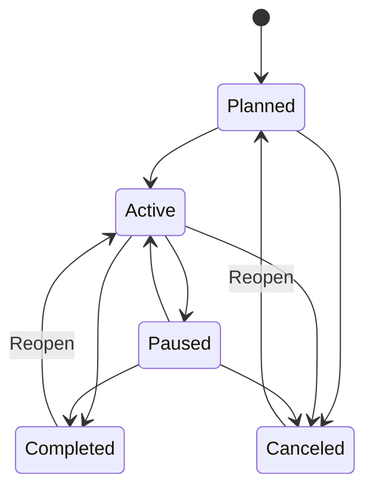

> 更新日期：2026-08-29 22:17 CST
> 更新说明：完成 Track `paused` 生命周期状态实施并记录验证结果。

# Track 暂停状态方案

## 1. 结论

为 Track 增加第五种生命周期状态 `paused`，产品界面显示为“Paused / 暂停”。它表示这段工作已经建立，但当前暂时不推进，并且预期未来恢复。

`paused` 是非终态，归入 Tracks 的 `Current` 范围，不允许直接归档。暂停 Track 不会自动暂停、取消或阻止其 Task 与 Agent Execution；它只表达 Track 整体推进状态。需要停止具体执行时，用户仍应在 Task 上取消 Execution 或调整 Task 状态。

新的状态集合为：

```text
planned / active / paused / completed / canceled
```

## 2. 产品语义

| 状态 | 含义 | Tracks 范围 | 可归档 |
| --- | --- | --- | --- |
| `planned` | 已规划，尚未开始 | Current | 否 |
| `active` | 正在推进 | Current | 否 |
| `paused` | 暂停推进，预期恢复 | Current | 否 |
| `completed` | 目标已经完成 | Completed | 是 |
| `canceled` | 工作被终止，不再计划恢复 | Completed | 是 |

`paused` 与 `canceled` 的区别：

- Paused：保留继续推进的意图，仍属于日常工作区；
- Canceled：明确终止，属于结束范围，并可归档。

## 3. 生命周期与转换

推荐主路径：



当前 Track 协议和编辑器没有强制状态转换图，具备管理权限的用户可以直接选择任一未归档状态。本次保持兼容，不新增服务端转换限制；上图用于表达推荐产品路径，而不是新增拒绝规则。

因此：

- 用户通常从 `active` 切换到 `paused`，再从 `paused` 恢复为 `active`；
- 已结束 Track 仍可按照现有能力重新打开到其他非终态；
- 已归档 Track 必须先 Restore，才能改为 `paused`；
- 不记录“暂停前状态”这一额外字段，恢复时由用户明确选择 `active` 或 `planned`，首版不提供自动 Resume 命令。

## 4. 列表、排序与展示

### 4.1 Desktop

- `paused` 出现在 `Current`；
- Current 排序改为 `active → paused → planned`，同状态继续按结束日期升序；
- Badge 使用低刺激的琥珀/黄色语义，文字为 `Paused`，不能只靠颜色区分；
- Track 创建和编辑下拉菜单增加 `Paused`；
- `paused` Track 不展示 Archive 操作；
- Track 详情仍可查看、创建和编辑 Task，不改变现有权限。

### 4.2 Web

Web 当前是只读 Tracks 页面，但必须正确解析和分类 `paused`：

- `paused` 进入 Current；
- `completed` 与 `canceled` 进入 Completed；
- 未识别状态不应静默当成 Current，避免未来协议状态被错误展示；
- 状态文案继续显示为可读 label。

### 4.3 CLI 与 Agent

`buzz tracks create/list/update --status` 接受 `paused`。列表 scope 规则与 Desktop 一致：

- `--scope current`：`active / paused / planned`；
- `--scope completed`：`completed / canceled`；
- `--scope archived`：所有 archived Track，保留原状态。

CLI 不新增单独的 `pause` / `resume` 子命令，避免和通用 `update --status` 重复。

## 5. 协议与兼容性

线格式沿用现有 tag：

```text
t=track-status:paused
```

这是 additive change：

- 新 Relay 与客户端识别 `paused`；
- 旧客户端可能拒绝解析该 Track 或无法在筛选中正确归类，因此 Relay、CLI、Desktop 和 Web 应在同一次变更中同步；
- 不需要数据库迁移；Track State 仍是 Relay 签名的当前状态事件；
- 不新增 event kind、HTTP endpoint 或权限规则；
- `paused` 不具备 `can_archive`，只有 `completed / canceled` 保持可归档。

Mobile 当前尚未实现 Tracks 产品面，因此本次不增加不存在的 Mobile Track UI；未来实现时直接采用五状态模型。

## 6. 任务与执行边界

暂停 Track 不等于暂停 Task：

- 已运行的 Agent Execution 不自动取消；
- Task 仍可创建、编辑、拖拽、执行或完成；
- Track 进度仍从可见 Task 实时计算；
- Track ACL、Task 与 Track 的可见性交集保持不变。

这是刻意的产品边界。自动暂停全部执行会引入批量副作用、部分失败、权限差异和恢复一致性问题，不应隐藏在一次 Track 状态修改中。若以后需要“暂停 Track 并停止全部工作”，应设计成明确的批量操作并单独确认影响范围。

## 7. 测试与验收

- Core 单元测试覆盖 `paused` 字符串解析、序列化和不可归档；
- SDK builder 测试覆盖 Create/Mutate 输出 `track-status:paused`；
- Relay E2E 覆盖创建/更新为 paused，并验证归档被拒绝；
- CLI 覆盖参数接受、Current scope 归类与排序；
- Desktop 纯逻辑测试覆盖 Current 归类和 `active → paused → planned` 排序；
- Desktop E2E 覆盖创建/编辑选择 Paused、Badge 展示、Current 可见与无 Archive 操作；
- Web codec/页面测试覆盖 paused 在 Current、canceled 在 Completed，修复当前 Web 将非 completed 状态全部归入 Current 的过宽逻辑；
- 更新 Wiki 与 CLI testing runbook；
- 实施完成后运行相关 Rust、CLI、Desktop、Web 测试和构建，并按改动风险运行 `just ci`。

## 8. Constructive suggestion

建议状态值使用 `paused`，界面显示“Paused”，而不是使用 `blocked`：

- `paused` 表达 Track owner 主动暂停整体工作；
- `blocked` 更适合由障碍造成的被动状态，而且 Task 已经存在 `blocked`；
- 两者混用会让 Track 状态和 Task 状态难以区分。

另外不建议把 Paused 单独做成第四个范围 Tab。它仍是 Current 工作，只是排序在 Active 后面；单独 Tab 会增加导航复杂度并让用户漏看仍需恢复的工作。

## 9. Todolist

得到鹿鹿子大王确认后再修改代码；每个 Todo 只对应一个文件。

### 协议与 Relay

- [ ] `crates/buzz-core/src/track.rs`：增加 `TrackStatus::Paused`、wire 解析与不可归档测试。
- [ ] `crates/buzz-sdk/src/builders.rs`：增加 paused Create/Mutate builder 覆盖。
- [ ] `crates/buzz-test-client/tests/e2e_relay.rs`：覆盖 paused Track 写入、更新和归档拒绝。

### CLI

- [ ] `crates/buzz-cli/src/lib.rs`：让 create/list/update 的 status 参数接受 `paused`，并更新 Archive 帮助文案。
- [ ] `crates/buzz-cli/src/commands/tracks.rs`：把 paused 归入 Current，定义 `active → paused → planned` 排序并增加测试。
- [ ] `crates/buzz-cli/TESTING.md`：补充 paused live-testing 与 scope/归档预期。

### Desktop

- [ ] `desktop/src/features/tracks/types.ts`：扩展 `TrackStatus` 联合类型。
- [ ] `desktop/src/features/tracks/lib/trackEvents.ts`：接受并构建 `track-status:paused`。
- [ ] `desktop/src/features/tracks/lib/trackEvents.test.mjs`：覆盖 paused 解析、创建、更新和不可归档语义。
- [ ] `desktop/src/features/tracks/lib/trackProgress.ts`：把 paused 归入 Current，并调整 Current 排序。
- [ ] `desktop/src/features/tracks/lib/trackProgress.test.mjs`：覆盖 paused scope 与排序。
- [ ] `desktop/src/features/tracks/ui/TrackEditorDialog.tsx`：增加 Paused 状态选项。
- [ ] `desktop/src/features/tracks/ui/TrackList.tsx`：增加 Paused badge，并保持 Archive 仅对终态可见。
- [ ] `desktop/tests/e2e/tracks.spec.ts`：覆盖 Paused 编辑、Current 展示、Badge 和 Archive 隐藏。
- [ ] `desktop/src/testing/e2eBridge.ts`：让 mock Track 事件更新流程接受 paused fixture。

### Web 与文档

- [ ] `web/src/features/tracks/types.ts`：定义五值 TrackStatus，避免无约束字符串。
- [ ] `web/src/features/tracks/eventCodec.ts`：严格解析五种 Track 状态并拒绝未知状态。
- [ ] `web/src/features/tracks/TracksPage.tsx`：对齐 Current/Completed/Archived scope 规则和状态 label。
- [ ] `web/tests/e2e/domain-codecs.spec.ts`：覆盖 paused codec。
- [ ] `web/tests/e2e/work-console.spec.ts`：覆盖 paused/canceled 的列表范围归类。
- [ ] `wiki/concepts.md`：更新 Track 五状态、暂停语义和归档规则。
- [ ] `docs/2026-08-06-tracks-work-management-plan.md`：追加 paused 状态演进说明，保留原始首版决策记录。

## 10. 实施结果（2026-08-29）

Core、SDK、CLI、Desktop 与 Web 已同步支持 `paused`；Desktop 将其放在 Current 并按 `active → paused → planned` 排序，Web 也修正了 Current / Completed 的严格归类。Mobile 尚无 Tracks 产品面，因此无代码变更。

已通过相关 Rust 单元测试与编译检查、Desktop Track 逻辑测试、Desktop 13 个 Track E2E 场景，以及 Web domain codec 6 个 E2E 场景。独立 Relay live E2E 未在本轮新增；协议解析、归档约束和客户端真实交互已有覆盖。
